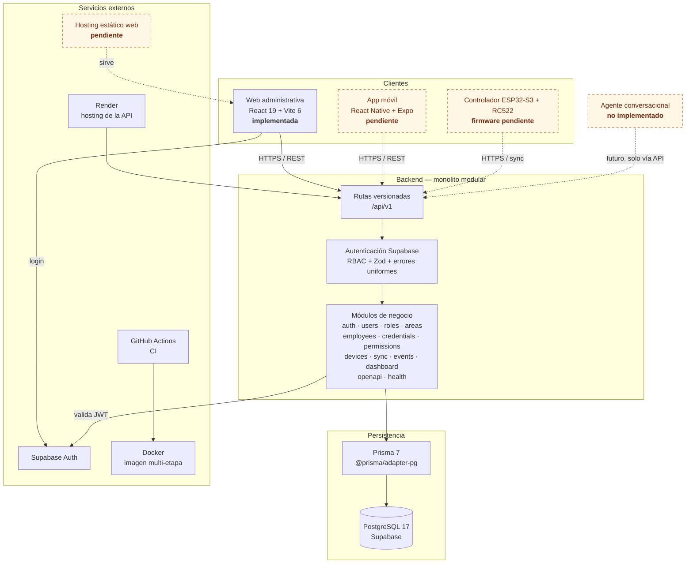
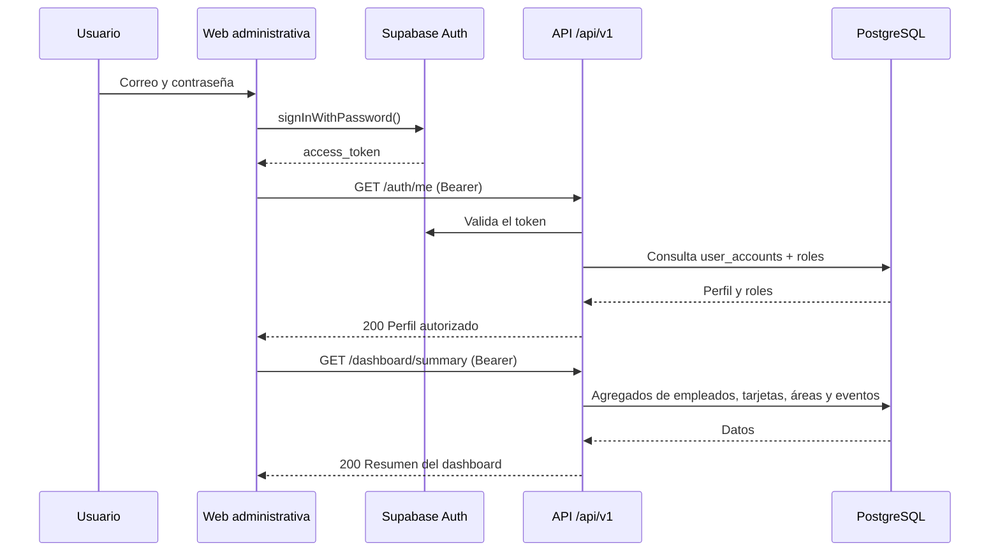

# Reporte de desarrollo — SCAccess

**Proyecto:** Sistema de Control de Acceso (SCAccess)  
**Institución:** Universidad Tecnológica de Tijuana  
**Carrera:** Ingeniería en Desarrollo y Gestión de Software  
**Equipo:** [Integrante 1] · [Integrante 2] · [Integrante 3] · [Integrante 4]  
**Materia / grupo:** [Nombre de la materia] · [Grupo]  
**Docente:** [Nombre del docente]  
**Fecha de este reporte:** 11 de noviembre de 2026  
**Estado del documento:** borrador de entrega con secciones del agente marcadas como pendientes.

> **Nota importante sobre el alcance real.** El repositorio contiene una API REST,
> una base de datos PostgreSQL en Supabase y una web administrativa funcional.
> **No existe todavía un agente conversacional, una interfaz de chat ni una
> pantalla de gestión global de proyecto/equipo.** Por eso, los apartados que la
> actividad dedica al agente se dejan señalados como `PENDIENTE` y con una
> plantilla comentada; no se deben fabricar capturas ni describir funciones que
> no estén implementadas. La app móvil y el firmware del ESP32-S3 también están
> pendientes.

---

## Correspondencia con la actividad

| Apartado solicitado | Sección de este documento | Estado |
| --- | --- | --- |
| Breve presentación: problema, objetivo general y alcance del agente | [1. Presentación del proyecto](#1-presentación-del-proyecto) | Presentación completa; agente pendiente |
| Arquitectura general: frontend, backend, base de datos, servicios externos y módulos del agente | [2.1 Arquitectura](#21-arquitectura-general) | Arquitectura real; módulos del agente pendientes |
| Capturas de interfaces implementadas | [2.2 Interfaces implementadas](#22-interfaces-implementadas) | Implementadas; incluye guía de capturas |
| Interfaz de gestión/visualización de APIs | [2.3 Gestión y visualización de APIs](#23-gestión-y-visualización-de-las-apis) | Implementada parcialmente: documentación OpenAPI y credenciales de dispositivo |
| Interfaz conversacional del agente | [2.4 Interfaz conversacional del agente](#24-interfaz-conversacional-del-agente-pendiente) | **PENDIENTE** |
| Vista de funcionalidades globales del proyecto | [2.5 Vista de funcionalidades globales](#25-vista-de-funcionalidades-globales-del-proyecto) | Equivalente implementado: dashboard + cuentas/roles |

---

# 1. Presentación del proyecto

## 1.1 Problema que resuelve

En una instalación con varias áreas restringidas, el control de acceso manual
—llaves físicas, listas en papel u hojas de cálculo— dificulta saber con
precisión **quién entró, a qué área, cuándo y con qué autorización**. También
dificulta revocar accesos con rapidez, conservar evidencia para auditoría y
operar cuando el lector físico pierde conexión a Internet.

SCAccess resuelve ese problema con:

- Tarjetas RFID asociadas a empleados y a permisos por área.
- Un controlador físico ESP32-S3 con lector RC522 que puede validar accesos
  **offline** y sincronizar después los eventos almacenados.
- Una API central que concentra las reglas de negocio y es la única capa con
  acceso a la base de datos.
- Una consola administrativa para gestionar empleados, tarjetas, áreas,
  permisos, controladores y cuentas.
- Un historial de accesos append-only que distingue `occurredAt` (hora del
  lector) de `receivedAt` (hora del servidor) y usa `clientEventId` para evitar
  eventos duplicados.

> **Estado de implementación:** la API y la consola web están implementadas; el
> firmware del ESP32-S3 y la app móvil están pendientes. El backend ya expone y
> prueba los contratos de sincronización que consumirá el controlador.

## 1.2 Objetivo general

Centralizar y automatizar el control de acceso de empleados a las áreas de una
instalación mediante tarjetas RFID, manteniendo un historial auditable y
permitiendo que el controlador físico siga operando sin Internet, mientras la
web administrativa ofrece gestión y monitoreo en tiempo real.

### Objetivos específicos

1. Administrar el catálogo de empleados, tarjetas RFID, áreas y permisos de
   acceso desde una consola web.
2. Autenticar y autorizar a los usuarios administrativos con Supabase Auth y
   roles (`admin`, `operator`, `auditor`).
3. Registrar cada intento de acceso con su decisión (`granted`/`denied`), motivo,
   área, tarjeta, empleado y marcas de tiempo.
4. Permitir que el ESP32-S3 descargue configuración, valide localmente y suba
   eventos cuando recupere la conexión.
5. Ofrecer un dashboard con indicadores de empleados, tarjetas, áreas,
   controladores y accesos de las últimas 24 horas.
6. Exponer una API REST versionada y documentada con OpenAPI 3.1.

## 1.3 Alcance del agente dentro del sistema

> **PENDIENTE / NO IMPLEMENTADO.** En el estado actual del repositorio **no hay
> agente conversacional, módulo de IA, integración con un proveedor de LLM ni
> herramientas (tools) expuestas a un agente**. El alcance aprobado del proyecto
> es el control de acceso RFID con API y consola administrativa. Por lo tanto,
> este apartado se reserva para cuando el equipo apruebe el diseño del agente.

Lo que sí puede afirmarse hoy:

| Aspecto del agente | Estado actual |
| --- | --- |
| Interfaz conversacional | No existe |
| Proveedor de LLM | No integrado |
| Módulos de intención/orquestación | No implementados |
| Herramientas o acciones del agente | No definidas |
| Memoria, RAG o base vectorial | No implementados |
| Guardrails y auditoría del agente | No aplica todavía |
| Captura de pantalla | No disponible; no se debe simular |

**Criterio de alcance recomendado para una futura incorporación:** el agente
debería ser una capa de apoyo sobre la API existente, no un sustituto de la
autorización del backend. No debería conectarse directamente a PostgreSQL ni
ejecutar acciones destructivas; cualquier consulta o acción tendría que pasar
por los mismos endpoints, respetar el rol del usuario y dejar traza. Esta
propuesta **no está aprobada** y debe documentarse en una ADR antes de
implementarse.

<!--
PLANTILLA PARA CUANDO EL AGENTE ESTÉ APROBADO:

### Alcance propuesto
- Preguntas que resolverá: estado de accesos, empleados, tarjetas, dispositivos,
  eventos y permisos.
- Acciones permitidas: consultar, filtrar, resumir y navegar; opcionalmente,
  preparar formularios para confirmación humana.
- Acciones prohibidas: eliminar historial, otorgar permisos sin confirmación,
  cambiar roles, revocar credenciales sin autorización.
- Límites: solo datos a los que el usuario autenticado tiene acceso; nunca
  acceso directo a la base de datos; registro de cada consulta/acción.

### Captura necesaria cuando exista
- `26-agente-chat.png`: ventana conversacional con una consulta y una respuesta.
- `27-agente-confirmacion.png`: confirmación de una acción propuesta por el agente.
-->

## 1.4 Alcance actual del proyecto

| Incluido y funcional | Pendiente o fuera de alcance |
| --- | --- |
| API REST `/api/v1` con Express 5 y TypeScript | App móvil en React Native + Expo |
| PostgreSQL 17 en Supabase con Prisma 7 | Firmware real del ESP32-S3 + RC522 |
| Supabase Auth y autorización por roles | Agente conversacional / IA |
| Web administrativa React 19 + Vite 6 | Portal de métricas o gestión avanzada de API keys |
| Dashboard, catálogos, bitácora y sincronización backend | Gestión de proyecto/equipo dentro de la consola |
| OpenAPI 3.1 y documentación interactiva | Despliegue declarado de la web administrativa |
| Docker, Render y CI con GitHub Actions | Integración de hardware real en esta etapa |

---

# 2. Desarrollo

## 2.1 Arquitectura general

SCAccess es un **monolito modular**: un solo backend desplegable, una base de
datos central y varios clientes. La API es la única capa con acceso directo a
PostgreSQL; la web, la app móvil y el controlador consumen contratos REST.

### 2.1.1 Diagrama de componentes



**Lectura del diagrama:** las líneas continuas representan lo implementado; las
líneas discontinuas y los nodos en amarillo representan componentes pendientes.
El agente no forma parte de la arquitectura actual.

### 2.1.2 Frontend: web administrativa

| Elemento | Implementación |
| --- | --- |
| Framework | React 19 + TypeScript 5.9 estricto |
| Bundler / servidor de desarrollo | Vite 6 |
| Ruteo | React Router 7 (`BrowserRouter`) |
| Autenticación | `@supabase/supabase-js` 2.49.4 |
| Iconografía | `lucide-react` |
| Pruebas | Vitest 5 + Testing Library + jsdom |
| Contratos compartidos | `@scaccess/shared` |

La consola es una SPA con rutas protegidas. El `AuthProvider` restaura la sesión
de Supabase, consulta `GET /api/v1/auth/me` y solo permite el acceso a cuentas
con rol `admin`, `operator` o `auditor`. Las páginas se cargan con `React.lazy`
para reducir el bundle inicial. El cliente HTTP agrega el token Bearer en cada
petición y normaliza errores de red, timeout y errores de la API.

Páginas implementadas:

| Ruta | Pantalla | Propósito |
| --- | --- | --- |
| `/login` | Inicio de sesión | Autenticación con correo y contraseña |
| `/` | Panel de control | KPIs, últimos eventos y salud de controladores |
| `/access-events` | Bitácora de accesos | Historial general inmutable con filtros y detalle |
| `/employees` | Empleados | Alta, edición, búsqueda y cambio de estado |
| `/credentials` | Tarjetas RFID | Inventario, alta y desactivación con motivo |
| `/permissions` | Permisos de acceso | Otorgamiento y revocación empleado-área |
| `/areas` | Áreas físicas | Catálogo y croquis operativo simulado |
| `/devices` | Controladores ESP32 | Inventario, áreas, sincronización y credenciales |
| `/users` | Cuentas y roles | Gobierno global de accesos a la consola (solo admin) |

### 2.1.3 Backend: API REST

| Elemento | Implementación |
| --- | --- |
| Runtime | Node.js >= 22.12 |
| Framework | Express 5 |
| Lenguaje | TypeScript 5.9 |
| Validación | Zod 4 |
| ORM | Prisma 7 (`prisma-client` + `@prisma/adapter-pg`) |
| Base de datos | PostgreSQL 17 en Supabase |
| Autenticación | Supabase Auth (JWT Bearer) |
| Autenticación de dispositivos | Credencial `<tokenId>.<secret>` |
| Seguridad | Helmet, CORS y autorización por roles |
| Pruebas | Vitest + Supertest |
| Documentación | OpenAPI 3.1 + página HTML interactiva |

Características relevantes:

- Todas las rutas cuelgan de `/api/v1`.
- Los errores usan el formato uniforme
  `{ error: { code, message, details? } }`.
- El cliente Prisma se crea de forma perezosa: la API puede arrancar y responder
  `/health` sin credenciales de base de datos.
- Los módulos están separados por responsabilidad (`routes`, `controller`,
  `service`, `schemas`).
- La API es la única capa con acceso a PostgreSQL.

### 2.1.4 Base de datos

- Motor: **PostgreSQL 17** en Supabase.
- Modelo: **12 tablas y 6 enums**.
- RLS habilitado en las 13 tablas de `public` (las 12 del dominio más
  `_prisma_migrations`).
- Migraciones aplicadas: init del modelo y habilitación de RLS/índices.
- El historial de accesos es **append-only**: no se elimina.
- `access_events` conserva `occurred_at`, `received_at`, `client_event_id` y
  `device_sequence` para auditoría e idempotencia.
- Los eventos de tarjetas desconocidas se conservan con `employee_id` nulo.

Tablas principales:

| Tabla | Propósito |
| --- | --- |
| `employees` | Personas que usan tarjetas |
| `user_accounts` | Cuentas de Supabase Auth vinculadas a un empleado |
| `roles` / `user_roles` | Roles administrativos y asignación N:M |
| `credentials` | Tarjetas RFID con UID único y estado |
| `areas` | Áreas físicas con zona horaria |
| `access_permissions` | Permisos empleado-área con vigencia y horario |
| `access_devices` | Controladores físicos y versión de configuración |
| `device_areas` | Áreas administradas por cada dispositivo |
| `device_sync_states` | Estado de sincronización por dispositivo |
| `device_credentials` | Credenciales de autenticación del dispositivo |
| `access_events` | Historial de intentos de acceso |

### 2.1.5 Servicios externos

| Servicio | Uso | Estado |
| --- | --- | --- |
| Supabase PostgreSQL | Base de datos administrada | Implementado |
| Supabase Auth | Login, JWT y sesiones | Implementado |
| Render | Hosting de la API | Implementado |
| GitHub Actions | Integración continua (lint, typecheck, test, build) | Configurado |
| Docker | Imagen multi-etapa del backend | Implementado |
| Hosting estático de la web | Publicación de la SPA | Pendiente de declarar |
| Proveedor de LLM | Agente conversacional | No integrado / no aprobado |

### 2.1.6 Módulos del agente

> **PENDIENTE.** No hay módulos de agente en el código. La arquitectura actual
> no incluye orquestador, herramientas, memoria ni integración con LLM.

<!--
PLANTILLA PARA COMPLETAR CUANDO SE APRUEBE:

- Orquestador de conversación: recibir el mensaje, mantener contexto y decidir
  el siguiente paso. Estado: no implementado.
- Clasificador de intención: distinguir consulta, resumen, navegación o acción.
  Estado: no implementado.
- Catálogo de herramientas: exponer funciones seguras sobre la API (consultar
  eventos, empleados, dispositivos). Estado: no implementado.
- Guardrail de permisos: verificar rol y alcance antes de cada consulta o acción.
  Estado: no implementado.
- Auditoría del agente: registrar consultas, decisiones y acciones ejecutadas.
  Estado: no implementado.
- Integración con LLM: proveedor, modelo, límites y manejo de errores.
  Estado: no implementado.

Regla de diseño: el agente nunca debe conectarse directo a PostgreSQL; debe usar
la API y respetar el mismo RBAC que la consola.
-->

### 2.1.7 Flujo de autenticación y consulta



La autorización real vive en el backend: ocultar un botón en la UI no protege un
endpoint. Cada petición vuelve a validar el token y el rol.

---

## 2.2 Interfaces implementadas

Esta sección es la evidencia visual del sistema. **Todas las capturas deben
tomarse de la aplicación real**, con datos de QA y sin secretos visibles. Usa la
cuenta administrativa de `docs/QA-TEST-DATA.md`; no publiques su contraseña en el
reporte.

**Convención sugerida para las figuras:**

```text

*Figura N. Pantalla de ...; muestra ... y sirve para ...*
```

Cada captura de formulario debe explicar en su pie qué formulario es y qué
permite hacer; el propósito general de la pantalla ya se describe en la sección
correspondiente.

### 2.2.1 Inicio de sesión

- **Ruta:** `/login`
- **Propósito:** autenticar al personal administrativo contra Supabase Auth y
  explicar que el acceso está limitado a roles `admin`, `operator` y `auditor`.
- **Qué debe verse:** tarjeta de login, campos de correo y contraseña, botón
  "Ingresar a la consola", selector de tema y el aviso de acceso exclusivo.
- **Captura requerida:** `01-login.png` (pantalla completa, tema oscuro).
- **Captura opcional:** `02-login-error.png` con un mensaje de credenciales
  inválidas, para evidenciar el manejo de errores.

> **Figura 1 — `01-login.png`.** Pantalla de inicio de sesión de la consola
> administrativa. Su propósito es autenticar al usuario y dejar claro que solo
> los roles administrativos pueden entrar.

### 2.2.2 Panel de control (dashboard)

- **Ruta:** `/`
- **Propósito:** dar una visión operativa global en segundos: empleados activos,
  tarjetas activas, áreas protegidas, controladores, accesos concedidos y
  denegados en las últimas 24 horas.
- **Qué debe verse:** las seis tarjetas KPI, el indicador de salud de la API en
  la barra superior, el estado de sincronización de controladores y, si existen
  datos, el banner de alerta por controladores desactualizados.
- **Captura requerida:** `03-dashboard.png` (parte superior).
- **Captura recomendada:** `04-dashboard-graficas.png` (parte inferior, con
  balance de decisiones, pulso de eventos y distribución por motivo).

> **Figura 2 — `03-dashboard.png`.** Centro de Monitoreo Operativo. Resume el
> estado del sistema y permite detectar de inmediato tarjetas, áreas o
> controladores que requieren atención.

> **Figura 3 — `04-dashboard-graficas.png`.** Visualizaciones de los últimos
> eventos. Complementan los KPIs con la proporción de accesos permitidos y
> denegados, la actividad por área y los motivos de decisión.

### 2.2.3 Bitácora de accesos

- **Ruta:** `/access-events`
- **Propósito:** auditar el historial general de lecturas. La pantalla distingue
  la hora del lector (`occurredAt`) de la hora de recepción (`receivedAt`) y
  conserva eventos de tarjetas desconocidas sin inventar un empleado.
- **Qué debe verse:** filtros por resultado, motivo, área, controlador, empleado,
  UID y rango de fechas; tabla paginada; indicador de total de eventos.
- **Captura requerida:** `05-bitacora.png`.
- **Captura recomendada:** `06-bitacora-detalle.png` con el modal de detalle de
  un evento, incluido un evento de tarjeta desconocida si existe en QA.

> **Figura 4 — `05-bitacora.png`.** Historial general de accesos. Es la evidencia
> principal de auditoría y permite reconstruir qué ocurrió, dónde y cuándo.

### 2.2.4 Empleados

- **Ruta:** `/employees`
- **Propósito:** administrar el directorio de empleados y su estado operativo sin
  alterar el historial de accesos.
- **Qué debe verse:** búsqueda por nombre/código/correo, filtros por estado y
  departamento, tabla paginada y acciones de edición.
- **Captura requerida:** `07-empleados.png`.
- **Captura recomendada:** `08-empleado-formulario.png` con el modal de alta o
  edición.

> **Figura 5 — `07-empleados.png`.** Catálogo de empleados. Centraliza los datos
> que se usan para vincular tarjetas, permisos y eventos de acceso.

### 2.2.5 Tarjetas RFID

- **Ruta:** `/credentials`
- **Propósito:** mantener el inventario de tarjetas, validar el UID hexadecimal y
  desactivar tarjetas con un motivo verificable.
- **Qué debe verse:** filtros por estado, empleado y UID; tabla con UID, etiqueta,
  empleado, estado y motivo de desactivación; acciones de edición.
- **Captura requerida:** `09-tarjetas.png`.
- **Captura recomendada:** `10-tarjeta-formulario.png` con el modal de registro o
  edición.

> **Figura 6 — `09-tarjetas.png`.** Inventario de tarjetas RFID. Permite
> relacionar cada tarjeta con un empleado y conservar la trazabilidad de su
> estado.

### 2.2.6 Permisos de acceso

- **Ruta:** `/permissions`
- **Propósito:** relacionar empleados con áreas protegidas, con vigencia
  opcional, y revocar permisos sin eliminar el historial. La API también modela
  un horario opcional (`schedule`), aunque la pantalla actual se centra en la
  vigencia.
- **Qué debe verse:** filtros, tabla de empleado-área, vigencia, estado y acciones
  de revocación; botón "Otorgar permiso".
- **Captura requerida:** `11-permisos.png`.
- **Captura recomendada:** `12-permiso-formulario.png` con el modal de
  otorgamiento o la confirmación de revocación.

> **Figura 7 — `11-permisos.png`.** Matriz de permisos de acceso. Es la pantalla
> que define qué empleado puede entrar a qué área y durante qué vigencia.

### 2.2.7 Áreas físicas y croquis operativo

- **Ruta:** `/areas`
- **Propósito:** administrar las zonas protegidas y visualizar, a modo de
  simulación, la ubicación del personal dentro del plano.
- **Qué debe verse:** croquis con zonas, ocupación, personas ubicadas, panel de
  lectura del plano, controles de simulación y catálogo de áreas debajo.
- **Captura requerida:** `13-areas-croquis.png` (croquis completo).
- **Captura recomendada:** `14-areas-catalogo.png` (tabla y botón "Nueva área").
- **Captura opcional:** `15-area-formulario.png`.

> **Figura 8 — `13-areas-croquis.png`.** Croquis de áreas y ubicación simulada
> del personal. Ayuda a interpretar la operación y a validar movimientos de
> entrada/salida sin hardware real.

> **Nota de honestidad:** el croquis indica explícitamente que es una
> **simulación**. No debe presentarse como telemetría real del ESP32-S3.

### 2.2.8 Controladores ESP32-S3

- **Ruta:** `/devices`
- **Propósito:** revisar el inventario de controladores, sus áreas asignadas, su
  estado de sincronización y emitir credenciales de dispositivo.
- **Qué debe verse:** tabla con nombre, código, ubicación, estado, áreas, versión
  de configuración, última conexión y acciones; botón "Nuevo controlador".
- **Captura requerida:** `16-controladores.png`.
- **Captura recomendada:** `17-controlador-formulario.png`.
- **Captura opcional:** `17b-controlador-sincronizacion.png` con el modal de
  estado de sincronización.
- **Captura opcional:** `18-credencial-dispositivo.png` con el token emitido
  **redactado** o revocado después de la captura.

> **Figura 9 — `16-controladores.png`.** Inventario y estado de sincronización de
> los controladores. Permite detectar dispositivos desactualizados o con eventos
> pendientes.

### 2.2.9 Cuentas y roles

- **Ruta:** `/users`
- **Propósito:** exclusivo de administradores. Vincula cuentas de Supabase Auth
  con empleados y asigna roles administrativos.
- **Qué debe verse:** tabla de cuentas, empleado vinculado, roles, estado, último
  acceso y botón "Nueva cuenta"; si se entra con un rol no administrador, la
  tarjeta de "Permisos insuficientes".
- **Captura requerida:** `19-cuentas-roles.png`.
- **Captura recomendada:** `20-cuenta-formulario.png`.

> **Figura 10 — `19-cuentas-roles.png`.** Administración global de cuentas y
> roles. Es la pantalla que gobierna quién puede usar la consola y con qué
> privilegios.

---

## 2.3 Gestión y visualización de las APIs

> **Alcance real:** SCAccess **no tiene un portal de API keys con métricas,
> rate limits y facturación**. Lo que sí existe es (a) documentación OpenAPI
> interactiva, (b) la especificación OpenAPI en JSON y (c) emisión/revocación de
> credenciales para dispositivos. Esta sección describe esas piezas y marca sus
> límites.

### 2.3.1 Documentación interactiva OpenAPI

- **URL local:** `http://localhost:3000/api/v1/docs`
- **URL de producción:** `https://scaccess-api.onrender.com/api/v1/docs`
- **Especificación:** `GET /api/v1/openapi.json` (OpenAPI 3.1.0)
- **Propósito:** consultar y probar los endpoints desde el navegador sin instalar
  Postman ni Swagger UI.

La página es autocontenida y permite:

- Ver los endpoints agrupados por etiquetas: Sistema, Autenticación, Catálogo,
  Credenciales, Dispositivos, Sincronización, Historial y Dashboard.
- Buscar por ruta o resumen.
- Seleccionar una operación y revisar su descripción, esquema de seguridad,
  parámetros, cuerpo de solicitud de ejemplo y códigos de respuesta.
- Introducir un token Bearer de Supabase (usuario) o una credencial de
  dispositivo (`<tokenId>.<secret>`) y enviar la petición.
- Ver el código HTTP y la respuesta JSON o de texto directamente en la página.

Endpoints que aparecen en la documentación:

| Grupo | Endpoints principales |
| --- | --- |
| Sistema | `GET /health`, `GET /openapi.json`, `GET /docs` |
| Autenticación | `GET /auth/me` |
| Catálogo | `GET/POST /users`, `GET /roles`, `GET/POST/PATCH /areas`, `GET/POST/PATCH /employees` |
| Credenciales | `GET/POST/PATCH /credentials` |
| Permisos | `GET/POST /access-permissions`, `POST /access-permissions/{id}/revoke` |
| Dispositivos | `GET/POST/PATCH /access-devices`, emisión y revocación de credenciales, `GET /access-devices/{id}/sync-state` |
| Sincronización | `GET /devices/{deviceId}/sync`, `POST /devices/{deviceId}/events/sync` |
| Historial | `GET /access-events`, `GET /access-events/{id}`, `GET /me/access-events` |
| Dashboard | `GET /dashboard/summary` |

Al cierre de este reporte, la especificación documenta **37 operaciones** bajo
`/api/v1`.

**Capturas requeridas:**

- `21-api-docs.png`: vista general con la lista de endpoints y el buscador.
- `22-api-docs-endpoint.png`: un endpoint seleccionado, por ejemplo
  `GET /dashboard/summary`, con parámetros y seguridad visibles.
- `23-api-docs-respuesta.png`: respuesta exitosa después de "Enviar solicitud".
  **El token debe estar enmascarado o ausente.**

> **Figura 11 — `21-api-docs.png`.** Documentación interactiva de la API. Permite
> explorar los contratos y probar endpoints sin salir del navegador.

> **Figura 12 — `22-api-docs-endpoint.png`.** Detalle de una operación. Muestra
> qué parámetros acepta, qué seguridad exige y qué respuestas devuelve.

### 2.3.2 Especificación OpenAPI

`GET /api/v1/openapi.json` devuelve el documento OpenAPI 3.1.0 que sirve como
contrato formal. Puede importarse en Postman, Insomnia, Apifox o Swagger UI, y
usarse para generar clientes o validar integraciones.

- **Captura opcional:** `24-openapi-json.png` con el JSON formateado en el
  navegador. No es indispensable si ya se muestra la documentación interactiva.

### 2.3.3 Gestión de credenciales de dispositivo

La forma de "clave de API" que existe en SCAccess es la **credencial del
controlador físico**:

- Se emite desde `/devices` con la acción de credencial.
- El token se muestra **una sola vez**; el backend guarda solo `secretHash`.
- La API permite revocar la credencial y el modelo conserva `lastUsedAt` y
  `expiresAt`. La consola actual expone la emisión y el estado; la revocación
  está disponible por endpoint.
- La autenticación del dispositivo usa `Authorization: Bearer <tokenId>.<secret>`.

**Captura opcional:** `18-credencial-dispositivo.png` con el token redactado. Si
se captura el token real, debe revocarse inmediatamente después y no publicarse.

### 2.3.4 Monitoreo disponible

| Función | Dónde se ve | Alcance |
| --- | --- | --- |
| Salud de la API | Topbar de la consola | `GET /health`, refresco cada 30 s |
| Estado de sincronización | Dashboard y `/devices` | Versión de configuración, última conexión, eventos pendientes |
| Eventos recientes | Dashboard | Últimos 8 eventos |
| Historial completo | `/access-events` | Filtros y detalle |
| Métricas de tráfico, latencia o errores por endpoint | No existe | Pendiente |
| Gestión de API keys de usuarios | No existe | Se usan JWT de Supabase |
| Rate limiting / cuotas | No existe | Pendiente |

**Captura recomendada:** `25-api-salud.png` con el indicador "API conectada" y el
tiempo activo en la barra superior. Puede ser un recorte de `03-dashboard.png`.

### 2.3.5 Qué permite hacer al usuario (resumen)

- **Consultar** todos los contratos de la API y sus esquemas.
- **Probar** endpoints con un token real de QA, viendo la respuesta inmediata.
- **Descargar/importar** la especificación OpenAPI en otras herramientas.
- **Emitir** credenciales de controladores desde la consola y **revocarlas** por
  el endpoint correspondiente.
- **Monitorear** la disponibilidad general de la API y el estado de
  sincronización de los dispositivos.
- **No permite** crear API keys de usuario, ver métricas por endpoint ni
  administrar cuotas; eso queda fuera del alcance actual.

---

## 2.4 Interfaz conversacional del agente (PENDIENTE)

> **NO IMPLEMENTADA.** No existe una pantalla de chat, un historial de
> conversaciones, un orquestador ni herramientas conectadas a un LLM. **No se
> debe incluir una captura ficticia ni describir un flujo como si ya funcionara.**

### Estado actual

| Elemento | Estado |
| --- | --- |
| Ventana de chat | No existe |
| Entrada de lenguaje natural | No existe |
| Respuestas del agente | No existen |
| Acciones ejecutables desde el chat | No definidas |
| Historial de conversación | No existe |
| Confirmación humana antes de acciones | No aplica |
| Captura | No disponible |

<!--
PLANTILLA PARA COMPLETAR CUANDO EL AGENTE EXISTA:

### Flujo típico de una interacción
1. El usuario abre la interfaz conversacional desde la consola.
2. Escribe una consulta, por ejemplo: "¿Cuántos accesos denegados hubo hoy en el
   laboratorio?".
3. El agente identifica la intención y consulta la API con el token del usuario.
4. El agente responde con un resumen y, si aplica, muestra una tabla o enlace a
   la pantalla correspondiente.
5. Si la consulta deriva en una acción (por ejemplo, preparar la revocación de un
   permiso), el agente muestra un borrador y pide confirmación explícita.
6. La acción se ejecuta con el mismo RBAC del backend y queda registrada.

### Tipos de respuesta/acción
- Consulta y resumen de eventos, empleados, tarjetas, áreas y dispositivos.
- Filtros y navegación asistida a una pantalla de la consola.
- Explicación de un evento o de un estado de sincronización.
- Preparación de formularios con confirmación humana.
- Acciones prohibidas: eliminar historial, cambiar roles o revocar credenciales
  sin autorización.

### Capturas necesarias
- `26-agente-chat.png`: conversación con una consulta y una respuesta.
- `27-agente-confirmacion.png`: confirmación de una acción propuesta.
-->

---

## 2.5 Vista de funcionalidades globales del proyecto

La actividad pide una vista donde el equipo o el administrador pueda ver y
gestionar las funcionalidades globales. En SCAccess **no existe una pantalla de
gestión de proyecto/equipo separada**. La equivalencia implementada son dos
vistas complementarias:

### 2.5.1 Panel de control: visión global operativa

- **Ruta:** `/`
- **Qué muestra:** el estado de todo el sistema en una sola pantalla —empleados,
  tarjetas, áreas, controladores, accesos de las últimas 24 horas, alertas de
  sincronización y últimos eventos.
- **Relación con el trabajo colaborativo:** es la fuente de verdad compartida que
  todo el equipo consulta para saber si el sistema está operativo. Un integrante
  puede detectar un controlador desactualizado y otro puede ir a `/devices` a
  revisarlo; ambos ven el mismo estado.

### 2.5.2 Cuentas y roles: gobierno global de acceso

- **Ruta:** `/users`
- **Qué permite:** crear y editar cuentas, vincularlas a empleados y asignar
  roles (`admin`, `operator`, `auditor`). Es la única pantalla exclusiva del
  administrador y gobierna el acceso a todos los módulos.
- **Relación con el trabajo colaborativo:** el equipo puede repartir
  responsabilidades con privilegio mínimo:
  - `admin`: configuración completa, cuentas, roles y credenciales de dispositivo.
  - `operator`: operación de empleados, tarjetas, permisos y lectura de
    dispositivos.
  - `auditor`: consulta y auditoría sin escritura.
- **Trazabilidad:** la pantalla muestra el último acceso de cada cuenta y el
  backend valida el rol en cada petición. No es solo una restricción visual.
- **Buena práctica para el equipo:** cada integrante debe usar su propia cuenta;
  no se comparten credenciales. Así se puede distinguir quién consulta y quién
  modifica, y el rol `auditor` sirve para revisar sin alterar datos.

### 2.5.3 Lo que no incluye esta vista

| Función de gestión global | Estado |
| --- | --- |
| Administrar cuentas y roles del sistema | Implementado en `/users` |
| Ver estado global del sistema | Implementado en `/` |
| Gestionar tareas, sprints o tablero del equipo | No implementado |
| Integración con GitHub, repositorio o CI desde la consola | No implementado |
| Chat o espacio de trabajo del equipo | No implementado |
| Configuración global de la aplicación | No existe una pantalla dedicada |

> **Nota para la entrega:** si la rúbrica exige una pantalla distinta de
> "gestión de proyecto/equipo", debe marcarse como pendiente. No conviene
> presentar `/users` como si fuera un tablero de gestión de tareas: su función
> real es la gobernanza de cuentas y roles.

**Capturas requeridas:**

- `19-cuentas-roles.png` (ya considerada en 2.2.9).
- `03-dashboard.png` (ya considerada en 2.2.2).
- `20-cuenta-formulario.png` (recomendada) para evidenciar la asignación de
  roles.

---

# 3. Matriz consolidada de capturas

> **Prioridad:** **O** = obligatoria, **R** = recomendada, **X** = opcional.
> Todas las capturas deben ser de la app real y usar datos de QA.

| # | Sección | Archivo sugerido | Qué debe mostrar | Prioridad |
| --- | --- | --- | --- | --- |
| 1 | 2.2.1 Login | `01-login.png` | Pantalla de login completa, tema oscuro | O |
| 2 | 2.2.1 Login | `02-login-error.png` | Error de credenciales inválidas | X |
| 3 | 2.2.2 Dashboard | `03-dashboard.png` | KPIs, topbar con salud de API y estado de dispositivos | O |
| 4 | 2.2.2 Dashboard | `04-dashboard-graficas.png` | Gráficas de balance, pulso y motivos | R |
| 5 | 2.2.3 Bitácora | `05-bitacora.png` | Filtros y tabla de eventos | O |
| 6 | 2.2.3 Bitácora | `06-bitacora-detalle.png` | Modal de detalle de un evento | R |
| 7 | 2.2.4 Empleados | `07-empleados.png` | Listado con filtros y acciones | O |
| 8 | 2.2.4 Empleados | `08-empleado-formulario.png` | Modal de alta/edición | R |
| 9 | 2.2.5 Tarjetas | `09-tarjetas.png` | Inventario con estados y filtros | O |
| 10 | 2.2.5 Tarjetas | `10-tarjeta-formulario.png` | Modal de registro/edición | R |
| 11 | 2.2.6 Permisos | `11-permisos.png` | Matriz empleado-área y acciones | O |
| 12 | 2.2.6 Permisos | `12-permiso-formulario.png` | Otorgamiento o revocación | R |
| 13 | 2.2.7 Áreas | `13-areas-croquis.png` | Croquis con zonas y ocupación | O |
| 14 | 2.2.7 Áreas | `14-areas-catalogo.png` | Catálogo y botón "Nueva área" | R |
| 15 | 2.2.7 Áreas | `15-area-formulario.png` | Modal de área | X |
| 16 | 2.2.8 Controladores | `16-controladores.png` | Inventario y estado de sincronización | O |
| 17 | 2.2.8 Controladores | `17-controlador-formulario.png` | Modal de controlador y áreas | R |
| 17b | 2.2.8 Controladores | `17b-controlador-sincronizacion.png` | Modal de estado de sincronización | R |
| 18 | 2.2.8 Controladores | `18-credencial-dispositivo.png` | Credencial emitida con token redactado | X |
| 19 | 2.2.9 / 2.5 | `19-cuentas-roles.png` | Tabla de cuentas, roles y estados | O |
| 20 | 2.2.9 / 2.5 | `20-cuenta-formulario.png` | Modal de cuenta y roles | R |
| 21 | 2.3.1 API | `21-api-docs.png` | Documentación interactiva, lista de endpoints | O |
| 22 | 2.3.1 API | `22-api-docs-endpoint.png` | Endpoint seleccionado con parámetros | O |
| 23 | 2.3.1 API | `23-api-docs-respuesta.png` | Respuesta de una solicitud de prueba | R |
| 24 | 2.3.2 API | `24-openapi-json.png` | Documento OpenAPI en JSON | X |
| 25 | 2.3.4 API | `25-api-salud.png` | Indicador "API conectada" en topbar | R |
| 26 | 2.4 Agente | `26-agente-chat.png` | **No disponible hasta implementar el agente** | PENDIENTE |
| 27 | 2.4 Agente | `27-agente-confirmacion.png` | **No disponible hasta implementar el agente** | PENDIENTE |

**Juego mínimo para entregar:** 1, 3, 5, 7, 9, 11, 13, 16, 19, 21 y 22.
**Juego recomendado:** agrega 4, 6, 8, 10, 12, 14, 17, 17b, 20, 23 y 25.

---

# 4. Guion sugerido para tomar las capturas

1. **Preparar el entorno.** Arranca la API (`npm run dev`) y la consola
   (`npm run dev:admin`). Verifica `http://localhost:3000/api/v1/health` y abre
   `http://localhost:5173/login`.
2. **Iniciar sesión con la cuenta administrativa de QA.** No uses datos reales ni
   publiques la contraseña. Si la API está en Render, espera el cold start.
3. **Capturar login y dashboard.** Usa una ventana de 1440×900, zoom 100 %,
   tema oscuro y sin barra de marcadores. Para páginas largas, usa captura de
   página completa o dos tomas consecutivas.
4. **Recorrer los módulos en orden:** bitácora, empleados, tarjetas, permisos,
   áreas, controladores y cuentas/roles. En cada uno, espera a que terminen los
   estados de carga.
5. **Capturar al menos un formulario.** Abre el modal, llena datos de QA y
   captura antes de guardar; si guardas, usa un registro de prueba y documenta el
   cambio.
6. **Capturar la documentación de API.** Abre `/api/v1/docs`, selecciona un
   endpoint y pega un token de QA. Enmascara el token antes de la captura o
   tómalo vacío. No publiques JWT completos.
7. **Revisar privacidad.** Oculta correos personales, tokens, secretos de
   dispositivo y cualquier dato que no sea del catálogo QA.
8. **Nombrar y ordenar los archivos** según la matriz de la sección 3. Guarda las
   imágenes en `docs/capturas/` o en la carpeta que indique el docente.
9. **Agregar pies de figura.** Cada imagen debe llevar número, nombre de la
   pantalla, propósito y fecha de captura.
10. **Verificar el documento renderizado.** Abre el `.md` en el visor final y
    confirma que los diagramas Mermaid y las imágenes se ven correctamente.

---

# 5. Limitaciones y notas de honestidad

- **No hay agente conversacional.** Las secciones 1.3, 2.1.6 y 2.4 quedan
  pendientes. No se deben inventar capturas ni respuestas del agente.
- **No hay app móvil implementada.** No incluyas capturas de una app que no
  existe. El historial personal está implementado en la API (`/me/access-events`)
  pero no hay cliente móvil terminado.
- **No hay firmware real del ESP32-S3.** La sincronización está implementada y
  probada en backend; el croquis de áreas es una simulación explícita.
- **No hay portal de API keys ni métricas de tráfico.** La documentación OpenAPI
  y las credenciales de dispositivo son las piezas reales de gestión de API.
- **No hay pantalla de gestión de proyecto/equipo.** El dashboard y
  `/users` son las vistas globales implementadas; no son un tablero de tareas.
- **Las capturas deben ser reales.** Si una pantalla no existe, se marca como
  pendiente en lugar de simularla.

---

# 6. Checklist de entrega

- [ ] El documento tiene título, datos del equipo y fecha.
- [ ] La presentación explica problema, objetivo general y alcance.
- [ ] El alcance del agente está marcado como pendiente y no se presenta como
      implementado.
- [ ] El diagrama de arquitectura se renderiza correctamente.
- [ ] Las capturas obligatorias de la sección 3 están incluidas.
- [ ] Cada captura tiene pie de figura y explicación de su propósito.
- [ ] La sección de APIs distingue documentación OpenAPI, credenciales de
      dispositivo y monitoreo disponible.
- [ ] La sección del agente está comentada o marcada como pendiente.
- [ ] La vista global se explica con dashboard + cuentas/roles y se aclara lo que
      no existe.
- [ ] No hay contraseñas, JWT, secretos de dispositivo ni datos personales
      reales en las imágenes.
- [ ] Las imágenes están en la carpeta correcta y con nombres consistentes.
- [ ] El documento se revisó en el visor final (GitHub, VS Code o el que use el
      docente).
