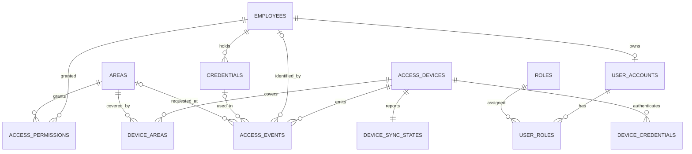

# Auditoria arquitectonica - Mision 01.1

- **Proyecto:** Sistema de Control de Acceso (`scaccess`)
- **Rama auditada:** `feat/backend-foundation` (commit `33b5942`)
- **Fecha:** 2026-10-29
- **Rol:** ingeniero de software senior / agente de implementacion
- **Autoridad de aprobacion:** lider tecnico (ChatGPT)
- **Alcance:** auditoria de la fundacion tecnica, ADRs, modelo de datos
  conceptual, funcionamiento offline, seguridad y skills instalados.
- **Restricciones respetadas:** no se modifico codigo, no se crearon tablas ni
  migraciones, no se instalaron dependencias, no se cambiaron ramas, no se
  hicieron commits, no se conecto Supabase y no se desplego nada.

> **Veredicto:** la fundacion tecnica es solida y reproducible, pero el
> proyecto **no esta listo para congelar el modelo definitivo de base de datos**
> hasta que el lider tecnico apruebe las decisiones marcadas como CRITICAS en
> este documento (principalmente semantica dispositivo-area, permisos
> temporales, roles, taxonomia de eventos, idempotencia y autenticacion de
> dispositivos). La Mision 02 puede iniciar como **diseno y aprobacion**, no
> como implementacion de migraciones.

---

## 1. Resumen ejecutivo

### 1.1 Fortalezas verificadas

- Monorepo con npm workspaces funcional (`apps/api` y `packages/shared`).
- API Express 5 + TypeScript 5.9 estricto, ESM/NodeNext, con compilacion y
  ejecucion reales verificadas en la Mision 01.
- Prisma 7 con `prisma-client` + `@prisma/adapter-pg`, cliente perezoso y
  generacion sin credenciales de base de datos.
- Validacion de entorno con Zod con fallo temprano (verificado: `PORT` invalido
  termina con codigo 1).
- Middleware uniforme de errores, ruta versionada `/api/v1` y endpoint de salud.
- Pruebas iniciales con Vitest + Supertest (2 aprobadas en la Mision 01).
- Lint, typecheck, test y build en verde al cierre de la Mision 01; sin cambios
  de codigo posteriores (solo se agrego documentacion).
- `.env` ignorado, `.env.example` sin secretos, `.gitattributes` con LF,
  CI basico definido.
- Skills instalados como archivos Markdown, sin secretos, binarios ni scripts
  (111 archivos, ~390 KB), con lockfile de hashes.
- Git limpio, `main` estable y `feat/backend-foundation` como rama de trabajo;
  sin remoto ni pushes.

### 1.2 Debilidades principales

1. **Seguridad del flujo offline incompleta:** no existe autenticacion de
   dispositivos; los contratos previstos permiten descargar empleados/tarjetas
   y subir eventos sin identidad de dispositivo definida.
2. **Decisiones de modelo que bloquean el esquema:** semantica dispositivo-area
   (N:M vs lector por area), vigencia/horarios de permisos, modelo de roles y
   taxonomia de motivos de decision.
3. **Historial de eventos incompleto en el documento actual:** no define
   snapshot de UID, motivo de rechazo, restriccion unica de idempotencia ni
   reglas de inmutabilidad.
4. **Errores HTTP incorrectos:** JSON malformado y payloads demasiado grandes
   terminan en `500` en lugar de `400`/`413`; ademas se registra el cuerpo del
   request en el log (verificado).
5. **Configuracion CORS/documentacion inconsistente:** el codigo usa `*` por
   defecto y la documentacion dice `http://localhost:5173`.
6. **Contratos duplicados y divergentes:** `packages/shared`, la API y
   `docs/API-CONTRACTS.md` no son una sola fuente de verdad.
7. **Estrategia de conexion a Supabase incompleta:** no se define URL directa
   vs pooler, SSL, ni el uso de `directUrl` para migraciones.
8. **Sin politica offline de revocacion:** una tarjeta revocada puede seguir
   abriendo puertas hasta que el dispositivo sincronice.

### 1.3 Conteo de hallazgos

| Severidad | Cantidad |
| --- | ---: |
| CRITICO | 5 |
| ALTO | 24 |
| MEDIO | 39 |
| BAJO | 16 |
| INFORMATIVO | 19 |
| **Total** | **103** |

> El conteo corresponde a IDs unicos de las secciones 2 a 8 (T, A, D, O, S y
> K). Los 10 bloqueantes de la seccion 9 son una vista consolidada de esos
> mismos hallazgos y no se suman aparte.

---

## 2. Hallazgos tecnicos

### 2.1 Metodo y evidencia

Inspeccionados:

- `package.json` raiz, `apps/api/package.json`, `packages/shared/package.json`.
- `apps/api/tsconfig.json`, `tsconfig.build.json`, `packages/shared/tsconfig.json`.
- `apps/api/prisma.config.ts`, `prisma/schema.prisma`, `src/config/env.ts`,
  `src/config/prisma.ts`.
- `src/app.ts`, `src/server.ts`, middlewares, rutas, controlador de salud,
  `ApiError` y pruebas.
- `eslint.config.mjs`, `vitest.config.ts`, CI, `.env.example`, `.gitignore`,
  `.gitattributes`, `.nvmrc`.
- `docs/` completo y los 7 ADRs.
- `.agents/skills/` y `skills-lock.json`.
- Estado de Git.

Verificaciones ejecutadas en esta auditoria (sin modificar archivos del
proyecto):

- `Test-Path .env` → `False`.
- Peticion `POST /api/v1/health` con JSON malformado al servidor compilado →
  `500` (deberia ser `400`), con el cuerpo del request registrado en stderr.
- Inventario de skills por extension → 111 archivos `.md`, 0 scripts/binarios.
- Busqueda de patrones de secretos en skills → sin coincidencias.
- `git status`, `git branch -vv`, `git remote -v`, `git log`.

No se volvieron a ejecutar lint/typecheck/test/build porque no hubo cambios de
codigo desde la Mision 01; sus resultados constan en el informe de esa mision.

### 2.2 Monorepo y workspaces

| ID | Severidad | Hallazgo | Evidencia / recomendacion |
| --- | --- | --- | --- |
| T-01 | MEDIO | `apps/admin` y `apps/mobile` aun no son workspaces (no tienen `package.json`). | Es intencional en la Mision 01. Al inicializarlos habra que cambiar `workspaces` a `apps/*` y verificar el orden de build. |
| T-02 | MEDIO | Orden de workspaces: `apps/api` se ejecuta antes que `packages/*`. | Hoy no falla porque la API no consume `@scaccess/shared`. Si se adopta el paquete compartido, el build/typecheck puede fallar por orden. Usar project references o ejecutar `packages/shared` primero. |
| T-03 | BAJO | Scripts `lint` por workspace existen pero el lint real es global (`eslint .` en la raiz). | No es un error, pero puede confundir. Documentar que el lint se ejecuta desde la raiz o eliminar los scripts redundantes. |
| T-04 | BAJO | No hay script `start` en la raiz. | `npm start --workspace @scaccess/api` funciona; agregar un alias raiz mejora la DX. |
| T-05 | INFO | npm workspaces verificado con `package-lock.json` unico y enlaces `@scaccess/*`. | Correcto. |

### 2.3 TypeScript, ESM y build

| ID | Severidad | Hallazgo | Evidencia / recomendacion |
| --- | --- | --- | --- |
| T-06 | INFO | ESM/NodeNext con extensiones `.js` funciona en `tsx`, Vitest y `tsc`. | Verificado por build y ejecucion en la Mision 01. Mantener la convencion. |
| T-07 | BAJO | El cliente Prisma generado vive dentro de `src/generated/prisma`. | Funciona, pero mezcla codigo generado con fuente y se recompila en cada build. Alternativa: generarlo fuera de `src` y ajustar `rootDir`. No es bloqueante. |
| T-08 | BAJO | No hay formateador (Prettier) ni `packageManager`/Corepack. | El estilo depende de ESLint + EditorConfig. Para un equipo, un formateador reduce ruido. Decision de tooling pendiente. |
| T-09 | BAJO | No se usa `exactOptionalPropertyTypes`. | Opcional; el nivel estricto actual es razonable. |
| T-10 | INFO | `noUncheckedIndexedAccess`, `noUnusedLocals` y `noUnusedParameters` activos. | Buena base de seguridad de tipos. |

### 2.4 Prisma y base de datos

| ID | Severidad | Hallazgo | Evidencia / recomendacion |
| --- | --- | --- | --- |
| T-11 | ALTO | No hay estrategia de URL directa vs pooler para Supabase, ni SSL, ni `directUrl` para migraciones. | `prisma.config.ts` solo recibe `DATABASE_URL`. Supabase suele requerir un URI de pooler para la app y uno directo para migraciones. Proponer `DATABASE_URL` (runtime) + `DIRECT_URL` (migraciones) y documentar `sslmode`. |
| T-12 | MEDIO | El adaptador crea un `pg.Pool` con valores por defecto; no se configura tamano de pool, timeout ni SSL explicito. | `PrismaPg({ connectionString })` funciona, pero en produccion conviene pasar un `pg.Pool` configurado. El adaptador no cachea sentencias preparadas por defecto (verificado en `PrismaPgOptions`), lo que reduce el riesgo con el pooler en modo transaccion; aun asi validar SSL y limites. |
| T-13 | MEDIO | Estado de Prisma listo, pero no hay comando de validacion del esquema en CI (`prisma validate`). | Agregar `prisma validate` al CI cuando exista el modelo. |
| T-14 | INFO | `prisma generate` funciona con esquema sin modelos y sin `DATABASE_URL` (verificado). | Correcto para la fundacion. |
| T-15 | INFO | Cliente Prisma perezoso: la API arranca sin credenciales y falla solo al usar la BD. | Correcto y alineado con el requisito de la Mision 01. |
| T-16 | INFO | Prisma 7.10.1 estable; Prisma 8 solo existe como RC. | Ver ADR-0007. No actualizar sin aprobacion. |

### 2.5 Variables de entorno

| ID | Severidad | Hallazgo | Evidencia / recomendacion |
| --- | --- | --- | --- |
| T-17 | ALTO | `CORS_ORIGIN` por defecto es `*` en el codigo, pero `.env.example` usa `http://localhost:5173` y `docs/DEVELOPMENT.md` afirma que ese es el valor por defecto. | Inconsistencia real (codigo `env.ts:15` vs docs). Un despliegue sin `.env` queda con CORS abierto. Alinear documentacion y exigir origenes explicitos en produccion. |
| T-18 | MEDIO | En produccion, `DATABASE_URL` no es obligatoria; el proceso arranca aunque no haya base de datos. | Puede producir un despliegue "verde" que falla en la primera consulta. Validar `DATABASE_URL` como obligatoria cuando `NODE_ENV=production`. |
| T-19 | BAJO | `DATABASE_URL` usa `z.url()` y acepta cualquier esquema (por ejemplo `http://`). | Validar `postgresql://` o `postgres://` antes de pasarla al adaptador. |
| T-20 | MEDIO | Se cargan `SUPABASE_*` pero no se usan todavia. | Correcto como reserva, pero puede dar falsa sensacion de integracion. Documentar que son solo placeholders. |
| T-21 | INFO | `.env` no existe en el checkout y esta ignorado; `.env.example` no contiene secretos reales. | Correcto. |

### 2.6 Express, middleware y contratos

| ID | Severidad | Hallazgo | Evidencia / recomendacion |
| --- | --- | --- | --- |
| T-22 | ALTO | Los errores de `express.json()` (JSON malformado) se convierten en `500`, no en `400`. Verificado con una peticion real. | `errorHandler` solo reconoce `ApiError` y `ZodError`; ignora `error.status`/`error.type` de body-parser. Manejar `entity.parse.failed`, `entity.too.large` y respuestas 4xx. |
| T-23 | ALTO | El log de errores incluye el objeto completo; en el caso verificado incluyo el cuerpo del request. | Redactar/omitir `body`, headers y datos personales. Un JSON malformado podria contener credenciales. |
| T-24 | ALTO | Contratos duplicados y divergentes: `packages/shared` define `HealthCheckResponse`, `ApiErrorBody` y tipos de sync; la API define su propia interfaz de salud; `ApiErrorBody.details` es `ApiErrorDetail[]` en shared pero `unknown` en la API; los tipos de sync no reflejan el payload de `API-CONTRACTS.md`. | Elegir una fuente de verdad (shared), adoptarla con project references y agregar pruebas de contrato. |
| T-25 | MEDIO | No hay validacion de requests con Zod todavia (solo entorno). | Esperado para la Mision 01; se necesitara en cada endpoint de negocio. |
| T-26 | MEDIO | No hay limite de tasa ni de tamano especifico para sincronizacion; `express.json` fija 1 MB global. | Definir maximo de lote, eventos por request y backpressure antes de implementar sync. |
| T-27 | MEDIO | La salud es solo liveness; no hay readiness ni verificacion de base de datos. | Util para despliegues: separar `/health/live` y `/health/ready` (sin romper el contrato actual). |
| T-28 | MEDIO | Logging con `console.log/error`; sin request id, nivel, ni correlacion. | Para auditoria de accesos y soporte, adoptar un logger estructurado simple (sin sobredimensionar). |
| T-29 | BAJO | `app.ts` exporta `createApp()` y una instancia `app`; las pruebas usan la instancia. | Redundancia menor; elegir una convencion (factory para pruebas). |
| T-30 | BAJO | `ApiError.statusCode` es `number` libre y los codigos son strings libres. | Tipar estados/codigos conocidos o centralizarlos en un enum/const. |
| T-31 | BAJO | El apagado ordenado no tiene timeout ni fuerza salida si el servidor no cierra. | Agregar timeout de apagado y manejo de `unhandledRejection`. |
| T-32 | BAJO | `helmet()` aplica CSP por defecto; cuando se agregue Swagger UI podria requerir ajuste. | Informativo para la mision de documentacion. |
| T-33 | INFO | CORS, Helmet, `x-powered-by` deshabilitado y envelope de errores uniforme. | Buena base. |

### 2.7 Pruebas y calidad

| ID | Severidad | Hallazgo | Evidencia / recomendacion |
| --- | --- | --- | --- |
| T-34 | MEDIO | Solo 2 pruebas (salud y 404). No hay pruebas de configuracion invalida, body-parser, contrato de error ni modulos futuros. | Agregar pruebas cuando se toque cada area; incluir un caso de JSON malformado para evitar regresiones. |
| T-35 | MEDIO | No hay cobertura ni umbral de cobertura. | Opcional para el prototipo; decidir politica antes de crecer. |
| T-36 | MEDIO | CI sin `permissions` minimos, sin `timeout-minutes` y con acciones fijadas por tag mayor (`@v4`). | Endurecer el workflow (permisos de solo lectura, timeout, SHA si el equipo lo requiere). |
| T-37 | BAJO | CI ejecuta `prisma generate` de forma explicita y ademas los scripts `pre*` lo repiten (hasta 4 veces). | No es un error; simplificar para ahorrar tiempo. |
| T-38 | INFO | Lint, typecheck, test y build definidos y en verde al cierre de la Mision 01. | Mantener la puerta de calidad antes de cada commit. |
| T-39 | INFO | `npm install` reporto 0 vulnerabilidades en la Mision 01. | Repetir `npm audit` en cada actualizacion de dependencias. |

### 2.8 Git

| ID | Severidad | Hallazgo | Evidencia / recomendacion |
| --- | --- | --- | --- |
| T-40 | INFO | `main` en `7b8d954`; `feat/backend-foundation` en `33b5942`; arbol limpio; sin remoto. | Correcto segun la Mision 01. |
| T-41 | INFO | `main` no incluye el commit de documentacion del remoto que si esta en la rama de trabajo. | Esperado: la rama de trabajo avanzo. Se integrara cuando se apruebe. |
| T-42 | INFO | `.gitignore` cubre `node_modules`, `dist`, `.env`, logs, cobertura y el cliente Prisma generado. | Correcto. |
| T-43 | INFO | `.gitattributes` fuerza LF; `.editorconfig` define estilo. | Correcto. |

---

## 3. Revision de ADRs

### 3.1 Inventario y estados

| ADR | Decision | Estado declarado | Veredicto de auditoria |
| --- | --- | --- | --- |
| 0001 | Monorepo npm workspaces | Aprobado | Consistente; faltan ajustes al incorporar admin/mobile. |
| 0002 | Express + TypeScript + monolito modular | Aprobado | Consistente; falta decision de logging/observabilidad. |
| 0003 | Supabase PostgreSQL + Prisma 7 | Aprobado | Consistente; incompleto en pooling/SSL/direct URL. |
| 0004 | Supabase Auth | Aprobado (pendiente) | Consistente; faltan roles, RLS y validacion de token. |
| 0005 | REST/JSON + OpenAPI + Zod | Aprobado | Consistente; afirma adopcion de shared que aun no ocurre. |
| 0006 | Offline-first solo en el dispositivo | Aprobado | Consistente; faltan versionado, revocacion y cola. |
| 0007 | TypeScript 5.9 / Prisma 7.10 | **Propuesto** | La auditoria respalda la decision; requiere aprobacion formal. |

### 3.2 Evaluacion individual

#### ADR-0001 - Monorepo con npm workspaces

- **Estado:** aprobado.
- **Fortaleza:** decision correcta para el alcance; el lockfile unico y los
  enlaces de workspace funcionan.
- **Observacion A-01 (MEDIO):** afirma que el CI ejecuta lint, typecheck, test y
  build "de todos los workspaces", pero el lint real es global desde la raiz.
  No es contradictorio, pero conviene redactarlo con precision.
- **Observacion A-02 (MEDIO):** no define el orden de build ni project
  references para cuando `apps/api` consuma `packages/shared`.

#### ADR-0002 - Backend Node.js + Express + TypeScript

- **Estado:** aprobado.
- **Fortaleza:** monolito modular y TypeScript estricto son adecuados.
- **Observacion A-03 (MEDIO):** declara validacion de entrada con Zod, pero en
  la Mision 01 solo se valida el entorno. Es una expectativa futura, no una
  contradiccion.
- **Observacion A-04 (BAJO):** no hay decision sobre logging estructurado,
  request IDs ni manejo de errores de body-parser.

#### ADR-0003 - Supabase PostgreSQL + Prisma

- **Estado:** aprobado.
- **Fortaleza:** Prisma 7 con `prisma-client` y `@prisma/adapter-pg` es el flujo
  correcto; el cliente perezoso esta implementado.
- **Observacion A-05 (ALTO):** falta decidir URL de runtime (pooler) vs URL
  directa para migraciones, SSL y tamano de pool. Sin esto, la primera conexion
  real a Supabase puede fallar o agotar conexiones.
- **Observacion A-06 (MEDIO):** no se define el rol de base de datos del backend
  (privilegios minimos, separacion entre migracion y runtime).

#### ADR-0004 - Supabase Auth

- **Estado:** aprobado, integracion pendiente.
- **Fortaleza:** separa identidad de negocio (`employees`) de autenticacion
  (`user_accounts`).
- **Observacion A-07 (ALTO):** no define el modelo de roles ni la relacion
  `user_accounts` - `roles` (falta tabla puente); tampoco define el mecanismo de
  validacion del token en la API ni el uso de RLS.
- **Observacion A-08 (MEDIO):** no aclara si la app movil accedera a Supabase
  directamente o solo a la API. La arquitectura aprobada dice que la API es la
  unica capa con acceso a la BD; conviene reforzarlo en el ADR.

#### ADR-0005 - API REST/JSON con OpenAPI

- **Estado:** aprobado.
- **Fortaleza:** versionado `/api/v1` y envelope de errores implementados.
- **Observacion A-09 (MEDIO):** afirma que "los clientes usan el paquete
  `@scaccess/shared`", pero hoy no lo consume nadie. Es aspiracional.
- **Observacion A-10 (MEDIO):** no define paginacion, filtros, convencion de
  ids, codigos de error completos ni politica de deprecacion de versiones.

#### ADR-0006 - Offline-first solo en el dispositivo

- **Estado:** aprobado.
- **Fortaleza:** delimita correctamente el alcance offline.
- **Observacion A-11 (ALTO):** no define versionado de configuracion,
  autenticacion de dispositivo, politica de revocacion offline, tamano de cola
  ni comportamiento ante configuracion obsoleta. Sin estas decisiones no se
  puede implementar el contrato de sync.
- **Observacion A-12 (MEDIO):** no define el formato de `syncVersion` (el
  documento de contratos muestra un ejemplo timestamp:contador, pero no es una
  decision).

#### ADR-0007 - Seleccion de versiones

- **Estado:** propuesto.
- **Fortaleza:** el analisis es correcto y esta respaldado por los peer ranges
  reales (`typescript-eslint` exige `<6.1.0`) y por que Prisma 8 es RC.
- **Observacion A-13 (MEDIO):** sigue pendiente de aprobacion; es la unica
  decision de tooling sin confirmar y afecta la reproducibilidad.
- **Recomendacion:** aprobar ADR-0007 tal como esta (TypeScript 5.9.3, Prisma
  7.10.1, Node 22 LTS).

### 3.3 Contradicciones e inconsistencias documentales

| ID | Severidad | Inconsistencia | Accion propuesta |
| --- | --- | --- | --- |
| A-14 | ALTO | CORS: codigo `*` por defecto; `.env.example` y `DEVELOPMENT.md` dicen `localhost:5173`. | Alinear documentacion y codigo; en produccion exigir origenes explicitos. |
| A-15 | ALTO | Contratos: `shared` vs API vs `API-CONTRACTS.md` no coinciden en campos ni `details`. | Unificar en `@scaccess/shared` y generar OpenAPI desde ahi. |
| A-16 | MEDIO | `DATABASE.md` dice que una tarjeta desconocida puede ser "no registrada o inactiva"; una tarjeta inactiva puede tener empleado asociado. | Separar "tarjeta desconocida" (sin credencial) de "tarjeta inactiva" (con credencial y empleado). |
| A-17 | MEDIO | `DATABASE.md` no enumera los estados de tarjeta exigidos (activa, bloqueada, perdida, baja). | Aprobarlos como enum explicito. |
| A-18 | BAJO | `API-CONTRACTS.md` dice que los eventos de tarjeta desconocida "se aceptan"; puede confundirse con acceso aceptado. | Aclarar: se acepta el registro, la decision es `denied`. |

### 3.4 Decisiones implementadas sin ADR

Se detectaron decisiones tecnicas ya materializadas que no tienen registro
formal. No son errores, pero deben documentarse o absorberse en ADRs nuevos:

- ESM + NodeNext con extensiones `.js` en imports.
- Un unico `.env` en la raiz y carga explicita con `dotenv` (Prisma 7 no lo hace).
- Cliente Prisma perezoso para permitir arranque sin credenciales.
- Envelope de errores y mapa inicial de codigos.
- CORS configurable por lista separada por comas.
- Versionado de skills en `.agents/` con `skills-lock.json`.
- Cliente Prisma generado dentro de `src/generated`.

### 3.5 ADRs recomendados para la Mision 02

1. **ADR-0008:** modelo de datos definitivo y convenciones (ids, timestamps,
   borrado logico, inmutabilidad).
2. **ADR-0009:** autenticacion y autorizacion de dispositivos fisicos.
3. **ADR-0010:** versionado de configuracion y sincronizacion de eventos.
4. **ADR-0011:** estrategia de conexion a Supabase (URL directa, pooler, SSL,
   roles y RLS).
5. **ADR-0012:** modelo de roles/permisos administrativos.
6. **ADR-0013:** observabilidad, logging y manejo de errores HTTP (incluye
   body-parser).
7. **ADR-0014:** fuente unica de contratos y estrategia OpenAPI.

---

## 4. Propuesta de modelo entidad-relacion

> **Estado:** propuesta de diseno. **No aprobada. No implementada.** No se
> modifico `schema.prisma` ni se creo ninguna migracion.

### 4.1 Principios propuestos

1. **PostgreSQL como fuente de verdad**; la API es la unica capa con acceso.
2. **Ids UUID** generados por la base (`gen_random_uuid()`) para todas las
   entidades; evita ids enumerables y facilita sincronizacion.
3. **Tiempos en `timestamptz`** (nunca `timestamp` sin zona).
4. **Historial inmutable:** `access_events` es append-only; el rol de runtime no
   tiene `UPDATE` ni `DELETE` sobre esa tabla.
5. **Borrado logico/estados** en empleados, tarjetas, areas y dispositivos; las
   FKs de historial usan `ON DELETE RESTRICT`.
6. **Snapshot en eventos:** cada evento conserva el UID de tarjeta y las
   referencias vigentes al momento del intento, aunque la tarjeta se reasigne
   despues.
7. **Idempotencia en la base:** restriccion unica, no solo validacion en codigo.
8. **Enums para estados estables** (tarjeta, decision, motivo) y tablas puente
   para relaciones N:M.
9. **Separar autenticacion de negocio:** `user_accounts` no reemplaza a
   `employees`.
10. **Permisos evaluables offline:** el modelo debe poder exportarse al
    dispositivo sin logica de servidor.

### 4.2 Enums propuestos

| Enum | Valores propuestos |
| --- | --- |
| `employee_status` | `active`, `inactive`, `suspended` |
| `credential_status` | `active`, `blocked`, `lost`, `retired` |
| `account_status` | `active`, `disabled` |
| `device_status` | `active`, `inactive`, `maintenance` |
| `access_decision` | `granted`, `denied` |
| `access_reason` | `allowed`, `card_unknown`, `card_blocked`, `card_lost`, `card_retired`, `employee_inactive`, `permission_missing`, `permission_expired`, `permission_outside_schedule`, `area_not_allowed`, `area_inactive`, `device_error` |

Notas:

- Los valores visibles en la interfaz se traducen al espanol en la capa de
  presentacion; los identificadores quedan en ingles.
- `access_reason` podria cambiar con el tiempo. Si el equipo prevé muchos
  motivos nuevos, evaluar una tabla catalogo en lugar de un enum (los enums
  PostgreSQL agregan valores facilmente pero no los eliminan).
- `credential_status` cubre el requisito explicito de tarjeta activa,
  bloqueada, perdida y dada de baja.

### 4.3 Entidades propuestas

#### `employees`

| Campo | Tipo | Restriccion |
| --- | --- | --- |
| `id` | `uuid` | PK, default `gen_random_uuid()` |
| `employee_code` | `varchar(32)` | NOT NULL, UNIQUE |
| `first_name` | `varchar(100)` | NOT NULL |
| `last_name` | `varchar(100)` | NOT NULL |
| `email` | `varchar(320)` | NULL, UNIQUE parcial sobre `lower(email)` |
| `department` | `varchar(100)` | NULL |
| `position` | `varchar(100)` | NULL |
| `status` | `employee_status` | NOT NULL, default `active` |
| `hired_at` | `date` | NULL |
| `deactivated_at` | `timestamptz` | NULL |
| `created_at` | `timestamptz` | NOT NULL, default `now()` |
| `updated_at` | `timestamptz` | NOT NULL, default `now()` |

- Un empleado puede tener 0..N tarjetas.
- No se elimina fisicamente; se marca `inactive` o `suspended`.
- Los campos definitivos siguen sujetos a aprobacion; esta es una base minima.

#### `user_accounts`

| Campo | Tipo | Restriccion |
| --- | --- | --- |
| `id` | `uuid` | PK |
| `auth_user_id` | `uuid` | NOT NULL, UNIQUE (id de Supabase Auth) |
| `employee_id` | `uuid` | NULL, UNIQUE, FK `employees(id)` ON DELETE RESTRICT |
| `email` | `varchar(320)` | NOT NULL, UNIQUE sobre `lower(email)` |
| `status` | `account_status` | NOT NULL, default `active` |
| `last_login_at` | `timestamptz` | NULL |
| `created_at` | `timestamptz` | NOT NULL |
| `updated_at` | `timestamptz` | NOT NULL |

- Relacion 1:0..1 con empleado: una cuenta puede ser de un empleado o de un
  administrador sin registro de empleado.
- No almacena contrasenas; la identidad la administra Supabase Auth.

#### `roles` y `user_roles`

| Tabla | Campos propuestos |
| --- | --- |
| `roles` | `id uuid PK`, `code varchar(32) UNIQUE`, `name varchar(100)`, `description text`, `is_system boolean`, timestamps |
| `user_roles` | `user_id uuid FK`, `role_id uuid FK`, `assigned_at timestamptz`, `assigned_by uuid NULL FK user_accounts`, PK `(user_id, role_id)` |

- Se propone `user_roles` aunque no estaba en la lista original: sin tabla
  puente no se pueden asignar varios roles y el modelo queda rígido.
- Roles iniciales sugeridos: `admin`, `operator`, `auditor`. El rol de
  empleado no se modela aqui: la app movil se autoriza por
  `user_accounts.employee_id`.

#### `credentials` (tarjetas RFID)

| Campo | Tipo | Restriccion |
| --- | --- | --- |
| `id` | `uuid` | PK |
| `employee_id` | `uuid` | NOT NULL, FK `employees(id)` ON DELETE RESTRICT |
| `card_uid` | `varchar(32)` | NOT NULL, UNIQUE, normalizado mayusculas sin separadores |
| `label` | `varchar(64)` | NULL |
| `status` | `credential_status` | NOT NULL, default `active` |
| `issued_at` | `timestamptz` | NULL |
| `deactivated_at` | `timestamptz` | NULL |
| `deactivation_reason` | `text` | NULL |
| `created_at` | `timestamptz` | NOT NULL |
| `updated_at` | `timestamptz` | NOT NULL |

- Un empleado puede tener varias tarjetas (1:N).
- `card_uid` es unico global; no se reutiliza en otra tarjeta.
- Los estados cubren activa, bloqueada, perdida y dada de baja.
- Se propone `CHECK (card_uid ~ '^[0-9A-F]{8,32}$')` y longitud par.
- No se elimina fisicamente; se pasa a `retired`.

#### `areas`

| Campo | Tipo | Restriccion |
| --- | --- | --- |
| `id` | `uuid` | PK |
| `code` | `varchar(32)` | NOT NULL, UNIQUE |
| `name` | `varchar(128)` | NOT NULL |
| `description` | `text` | NULL |
| `is_active` | `boolean` | NOT NULL, default `true` |
| `timezone` | `varchar(64)` | NOT NULL, default `America/Tijuana` (si hay horarios) |
| `created_at` | `timestamptz` | NOT NULL |
| `updated_at` | `timestamptz` | NOT NULL |

- `timezone` solo es necesario si los permisos tienen horarios; se propone
  incluirlo para evitar ambiguedad futura.
- No se elimina si tiene eventos o permisos.

#### `access_permissions`

| Campo | Tipo | Restriccion |
| --- | --- | --- |
| `id` | `uuid` | PK |
| `employee_id` | `uuid` | NOT NULL, FK `employees(id)` ON DELETE RESTRICT |
| `area_id` | `uuid` | NOT NULL, FK `areas(id)` ON DELETE RESTRICT |
| `valid_from` | `timestamptz` | NULL |
| `valid_to` | `timestamptz` | NULL |
| `schedule` | `jsonb` | NULL (horario semanal; estructura pendiente) |
| `revoked_at` | `timestamptz` | NULL |
| `granted_by` | `uuid` | NULL, FK `user_accounts(id)` |
| `created_at` | `timestamptz` | NOT NULL |
| `updated_at` | `timestamptz` | NOT NULL |

- Permiso por empleado-area; no por tarjeta.
- Opcion simple para el prototipo: un registro por `(employee_id, area_id)` con
  `revoked_at`; indice unico parcial `WHERE revoked_at IS NULL`.
- Opcion con historial completo: permitir multiples filas y registrar quien
  cambio que; requeriria tabla de auditoria adicional. **Decision pendiente.**
- Si se usan horarios, el dispositivo debe recibir `schedule` y `timezone`.

#### `access_devices`

| Campo | Tipo | Restriccion |
| --- | --- | --- |
| `id` | `uuid` | PK |
| `device_code` | `varchar(64)` | NOT NULL, UNIQUE (identificador estable) |
| `name` | `varchar(100)` | NOT NULL |
| `location` | `varchar(128)` | NULL |
| `status` | `device_status` | NOT NULL, default `active` |
| `hardware_model` | `varchar(32)` | NULL (por ejemplo `ESP32-S3`) |
| `firmware_version` | `varchar(32)` | NULL |
| `config_version` | `bigint` | NOT NULL, default 0 |
| `last_seen_at` | `timestamptz` | NULL |
| `provisioned_at` | `timestamptz` | NULL |
| `created_at` | `timestamptz` | NOT NULL |
| `updated_at` | `timestamptz` | NOT NULL |

- No se elimina fisicamente; se marca `inactive`.
- `config_version` es un contador monotono gestionado por el servidor.

#### `device_areas`

| Campo | Tipo | Restriccion |
| --- | --- | --- |
| `device_id` | `uuid` | FK `access_devices(id)` ON DELETE RESTRICT |
| `area_id` | `uuid` | FK `areas(id)` ON DELETE RESTRICT |
| `created_at` | `timestamptz` | NOT NULL |
| PK | `(device_id, area_id)` | |

- Relacion N:M: un dispositivo puede administrar varias areas.
- **Decision critica:** si un dispositivo controla varias areas, el evento debe
  indicar cual area/lector se uso. Se propone exigir `area_id` en
  `access_events` (configurado en el lector) y validar que
  `(device_id, area_id)` exista en `device_areas`.
- Si un dispositivo tiene varios lectores fisicos, se recomienda agregar una
  tabla `device_readers` (extension futura) con `reader_code` y `area_id`.

#### `device_sync_states`

| Campo | Tipo | Restriccion |
| --- | --- | --- |
| `device_id` | `uuid` | PK, FK `access_devices(id)` ON DELETE RESTRICT |
| `config_version` | `bigint` | NOT NULL, default 0 (version aplicada por el dispositivo) |
| `last_sync_requested_at` | `timestamptz` | NULL |
| `last_sync_completed_at` | `timestamptz` | NULL |
| `last_event_received_at` | `timestamptz` | NULL |
| `last_event_occurred_at` | `timestamptz` | NULL |
| `pending_event_count_reported` | `integer` | NULL (reportado por el dispositivo, no autoritativo) |
| `last_error_code` | `varchar(64)` | NULL |
| `last_error_at` | `timestamptz` | NULL |
| `updated_at` | `timestamptz` | NOT NULL |

- 1:1 con `access_devices`.
- El servidor no puede saber con certeza cuantos eventos faltan; el conteo es
  informativo.
- La version aplicada es la que reporta el dispositivo; la version vigente esta
  en `access_devices.config_version`.

#### `access_events` (append-only)

| Campo | Tipo | Restriccion |
| --- | --- | --- |
| `id` | `uuid` | PK |
| `device_id` | `uuid` | NOT NULL, FK `access_devices(id)` ON DELETE RESTRICT |
| `client_event_id` | `varchar(64)` | NOT NULL (idempotencia) |
| `device_epoch` | `uuid` | NULL (epoca de aprovisionamiento; trazabilidad) |
| `card_uid` | `varchar(32)` | NOT NULL (snapshot normalizado) |
| `employee_id` | `uuid` | NULL, FK `employees(id)` ON DELETE RESTRICT |
| `credential_id` | `uuid` | NULL, FK `credentials(id)` ON DELETE RESTRICT |
| `area_id` | `uuid` | NULL, FK `areas(id)` ON DELETE RESTRICT |
| `decision` | `access_decision` | NOT NULL |
| `reason_code` | `access_reason` | NOT NULL |
| `occurred_at` | `timestamptz` | NOT NULL (reloj del dispositivo) |
| `received_at` | `timestamptz` | NOT NULL, default `now()` (reloj del servidor) |
| `device_sequence` | `bigint` | NULL (secuencia local para diagnostico) |
| `metadata` | `jsonb` | NULL (firmware, lector, version de config, etc.) |
| `created_at` | `timestamptz` | NOT NULL, default `now()` |

Restricciones propuestas:

- `UNIQUE (device_id, client_event_id)`.
- `UNIQUE (device_id, device_sequence)` cuando `device_sequence` no sea nulo.
- `CHECK (card_uid <> '')`.
- `CHECK (decision <> 'granted' OR (employee_id IS NOT NULL AND credential_id IS NOT NULL))`.
- `CHECK (decision <> 'granted' OR reason_code = 'allowed')`.
- `CHECK (decision <> 'denied' OR reason_code <> 'allowed')`.
- No `updated_at` ni borrado; el rol de runtime solo `INSERT`/`SELECT`.

Reglas:

- Tarjeta desconocida: `credential_id = NULL`, `employee_id = NULL`,
  `card_uid` presente, `decision = denied`, `reason_code = card_unknown`.
- Tarjeta bloqueada/perdida/baja: `credential_id` y `employee_id` presentes,
  `decision = denied`, motivo especifico.
- Empleado inactivo: motivo `employee_inactive`.
- Area no permitida al dispositivo o sin permiso: motivos especificos.
- `area_id` recomendado como NOT NULL para eventos de dispositivos con lector
  asignado a un area; si se permite `NULL`, se pierde la trazabilidad del
  destino. **Decision pendiente.**
- `occurred_at` es dato reportado por el dispositivo (no confiable); el servidor
  puede calcular desviacion respecto a `received_at` y marcarla en `metadata`
  o en un campo futuro `clock_skew_seconds`.

#### `device_credentials` (propuesta de seguridad)

| Campo | Tipo | Restriccion |
| --- | --- | --- |
| `id` | `uuid` | PK |
| `device_id` | `uuid` | NOT NULL, FK `access_devices(id)` ON DELETE RESTRICT |
| `token_id` | `varchar(64)` | NOT NULL, UNIQUE (identificador publico) |
| `secret_hash` | `text` | NOT NULL (Argon2id/bcrypt; nunca texto plano) |
| `created_at` | `timestamptz` | NOT NULL |
| `expires_at` | `timestamptz` | NULL |
| `revoked_at` | `timestamptz` | NULL |
| `last_used_at` | `timestamptz` | NULL |

- Permite rotacion y multiples credenciales por dispositivo.
- Alternativa de produccion: mTLS por dispositivo. Decision pendiente.

### 4.4 Diagrama ER propuesto

### 4.5 Indices propuestos

| Tabla | Indice | Motivo |
| --- | --- | --- |
| `employees` | UNIQUE `employee_code` | Identificador de negocio |
| `employees` | UNIQUE parcial `lower(email)` | Evitar duplicados |
| `employees` | `(status)` | Filtros de administracion |
| `user_accounts` | UNIQUE `auth_user_id` | Vinculo con Supabase Auth |
| `user_accounts` | UNIQUE parcial `employee_id` | Una cuenta por empleado |
| `user_roles` | PK `(user_id, role_id)` + `(role_id)` | Consultas por rol |
| `credentials` | UNIQUE `card_uid` | Busqueda offline y unicidad |
| `credentials` | `(employee_id)`, `(status)` | Listado por empleado/estado |
| `access_permissions` | `(employee_id, area_id)`; parcial unico `WHERE revoked_at IS NULL` | Evitar permisos activos duplicados |
| `access_permissions` | `(area_id)`, `(valid_from, valid_to)` | Consultas de vigencia |
| `device_areas` | PK `(device_id, area_id)` + `(area_id)` | Autorizacion y consultas |
| `access_devices` | UNIQUE `device_code`; `(status)`, `(last_seen_at)` | Operacion |
| `device_credentials` | UNIQUE `token_id`; `(device_id)` | Autenticacion |
| `access_events` | UNIQUE `(device_id, client_event_id)` | Idempotencia |
| `access_events` | `(occurred_at DESC)` | Historial general |
| `access_events` | `(employee_id, occurred_at DESC)` | Historial personal |
| `access_events` | `(device_id, occurred_at DESC)` | Historial por dispositivo |
| `access_events` | `(area_id, occurred_at DESC)` | Historial por area |
| `access_events` | `(received_at)` (BRIN opcional si crece) | Ingesta y auditoria |

### 4.6 Notas de implementacion en Prisma 7

- Prisma no expresa indices unicos parciales ni `CHECK` directamente en el
  esquema; se implementaran en SQL revisado dentro de la migracion.
- La inmutabilidad de `access_events` se aplica con privilegios de base de
  datos (rol de runtime sin `UPDATE`/`DELETE`) y, opcionalmente, un trigger.
- `timestamptz` se mapea a `DateTime`; revisar que Prisma no convierta a
  `timestamp` sin zona.
- Los enums se pueden modelar con `enum` de Prisma; agregar valores es una
  migracion, eliminarlos requiere recrear el tipo. Para `access_reason`,
  decidir enum vs tabla catalogo antes de la primera migracion.
- `metadata jsonb` requiere `Json` en Prisma; definir un esquema Zod para su
  contenido antes de confiar en el.
- Los ids UUID con default de base se pueden expresar con `dbgenerated` o
  generar en la aplicacion; elegir una sola estrategia y documentarla.
- La migracion inicial debe revisarse manualmente antes de aplicarse; no hay
  base de datos real en esta mision.

### 4.7 Hallazgos y decisiones abiertas del modelo

| ID | Severidad | Hallazgo | Impacto |
| --- | --- | --- | --- |
| D-01 | **CRITICO** | Semantica dispositivo-area/lector sin definir: `device_areas` es N:M, pero el evento necesita saber que area/lector se uso. | Define `access_events.area_id`, el payload offline y la validacion. Bloquea el ER. |
| D-02 | **CRITICO** | Modelo de vigencia/horarios de permisos sin definir (`valid_from/valid_to`, `schedule`, timezone). | Cambia columnas, indices, validacion offline y pruebas. Bloquea el ER. |
| D-03 | ALTO | Modelo de roles incompleto: falta `user_roles` y el caso de administrador sin registro de empleado. | Afecta autorizacion de la web y RLS. |
| D-04 | ALTO | Los estados de tarjeta no estan enumerados en `DATABASE.md` (se requiere activa, bloqueada, perdida y baja). | Afecta `credential_status` y la logica offline. |
| D-05 | ALTO | Falta taxonomia de motivos de decision; `decision` por si sola no explica el rechazo. | Afecta `access_events.reason_code` y reportes. |
| D-06 | ALTO | No se define snapshot de `card_uid` ni de empleado en el evento; una tarjeta puede reasignarse. | Riesgo de historial ambiguo. |
| D-07 | ALTO | La idempotencia se menciona pero no se define la unicidad ni el caso de reset/reaprovision. | Riesgo de duplicados o perdida de eventos. |
| D-08 | MEDIO | `DATABASE.md` confunde "tarjeta desconocida" con "tarjeta inactiva". | Claridad del modelo y de los motivos. |
| D-09 | MEDIO | Campos y estrategia de `device_sync_states` sin definir. | Afecta estado de sincronizacion y UI administrativa. |
| D-10 | MEDIO | No hay plan de inmutabilidad, retencion o particionado de eventos. | Riesgo de borrado accidental o degradacion. |
| D-11 | MEDIO | No hay convencion de indices, tipos de tiempo ni longitudes. | Riesgo de esquema inconsistente. |
| D-12 | BAJO | No se decide entre `deleted_at` y campos de estado para borrado logico. | Inconsistencia futura entre entidades. |
| D-13 | INFO | La propuesta cubre las 10 entidades requeridas mas `user_roles` y `device_credentials`. | Base para la aprobacion. |

Decisiones abiertas consolidadas:

1. **Dispositivo-area/lector:** como se identifica el area del intento cuando
   un dispositivo cubre varias areas.
2. **Permisos temporales:** vigencia, horarios y timezone; una fila con
   revocacion o historial completo.
3. **Roles:** catalogo inicial, tabla puente y alcance de cada rol.
4. **Estados de tarjeta:** confirmar enum y transiciones permitidas.
5. **Motivos de decision:** lista cerrada vs catalogo.
6. **Snapshot de evento:** confirmar `card_uid` y `employee_id` historicos.
7. **Idempotencia:** formato de `client_event_id` y `device_epoch`.
8. **Retencion:** inmutable indefinido vs particionado/archivado (sin borrar).
9. **Area en evento:** `NOT NULL` o `NULL`.
10. **Borrado logico:** `deleted_at` vs campos `status`/`deactivated_at`.

---

## 5. Relaciones y cardinalidades

### 5.1 Matriz requisito -> solucion propuesta

| Requisito | Solucion propuesta |
| --- | --- |
| Una persona puede tener varias tarjetas | `employees 1---N credentials`; `credentials.employee_id NOT NULL`. |
| Tarjeta activa, bloqueada, perdida o dada de baja | Enum `credential_status` con esos cuatro valores. |
| Tarjeta desconocida genera evento rechazado | `access_events.credential_id NULL`, `employee_id NULL`, `card_uid` snapshot, `decision=denied`, `reason=card_unknown`. |
| Los eventos historicos no se eliminan | Append-only, FKs `ON DELETE RESTRICT`, rol sin `UPDATE`/`DELETE`, sin borrado fisico de empleados/tarjetas. |
| Distinguir autorizados y rechazados | `decision` (`granted`/`denied`) + `reason_code`. |
| Hora del evento vs hora de recepcion | `occurred_at` (dispositivo) y `received_at` (servidor). |
| Identificador unico para evitar duplicados | `UNIQUE (device_id, client_event_id)`; `device_epoch` para trazabilidad. |
| Un dispositivo puede administrar varias areas | `device_areas` N:M; `access_events.area_id` identifica el area del intento. |
| Estado de sincronizacion | `device_sync_states` 1:1 con dispositivo. |
| Separar cuentas de empleados | `user_accounts` 1:0..1 `employees`; `auth_user_id` unico. |
| Roles administrativos | `roles` + `user_roles` N:M. |

### 5.2 Cardinalidades definitivas propuestas

- `employees 1 --- 0..N credentials`.
- `employees 1 --- 0..N access_permissions`.
- `areas 1 --- 0..N access_permissions`.
- `employees 1 --- 0..1 user_accounts`.
- `user_accounts 0..N --- 0..N roles` mediante `user_roles`.
- `access_devices 0..N --- 0..N areas` mediante `device_areas`.
- `access_devices 1 --- 1 device_sync_states`.
- `access_devices 1 --- 0..N access_events`.
- `employees 0..1 --- 0..N access_events` (nullable para tarjeta desconocida).
- `credentials 0..1 --- 0..N access_events` (nullable para tarjeta desconocida).
- `areas 0..1 --- 0..N access_events` (segun decision de area obligatoria).

### 5.3 Reglas de integridad

- Un permiso activo duplicado para el mismo empleado-area no debe existir.
- Una tarjeta no puede pertenecer a dos empleados a la vez.
- Un evento `granted` debe tener empleado, credencial y area (si se aprueba
  area obligatoria), y motivo `allowed`.
- Un evento `denied` nunca debe tener motivo `allowed`.
- Un evento no puede existir sin dispositivo.
- Un evento no puede referenciar una credencial de otro empleado que el
  registrado en el evento (validacion de aplicacion, no solo FK).
- No se permite `UPDATE`/`DELETE` sobre `access_events` desde el rol de la API.

---

## 6. Requisitos de sincronizacion offline

> Diseno conceptual. No se implemento firmware ni endpoints.

### 6.1 Flujo completo propuesto

1. **Aprovisionamiento y autenticacion:** el dispositivo se registra y obtiene
   una credencial (token/mTLS) y un `device_id` estable.
2. **Descarga de configuracion:** `GET /api/v1/devices/{deviceId}/sync` entrega
   areas, empleados minimos, credenciales, permisos, mapeo dispositivo-area y
   una version de configuracion.
3. **Persistencia local atomica:** el dispositivo valida checksum/version,
   escribe en una particion temporal y hace swap; conserva la version anterior
   para rollback.
4. **Lectura de tarjeta:** el lector RC522 obtiene el UID y lo normaliza.
5. **Validacion local:** busca la credencial, valida estado de tarjeta y
   empleado, valida area del lector y permiso vigente/horario.
6. **Decision:** `granted` o `denied` con motivo.
7. **Registro write-ahead:** **primero** persiste el evento en la cola local y
   **despues** acciona el relé. Si falla la escritura, no se debe conceder el
   acceso (integridad del historial).
8. **Sincronizacion:** cuando hay Internet, envia lotes de eventos; el servidor
   deduplica y confirma por evento. El dispositivo elimina/marca solo los
   confirmados.
9. **Actualizacion de configuracion:** el dispositivo consulta cambios con
   `If-None-Match`/version y aplica la nueva configuracion.

### 6.2 Informacion que debe almacenar el dispositivo

| Dato | Proposito | Nota de seguridad |
| --- | --- | --- |
| `device_id` | Identidad | No es secreto |
| `device_epoch` | Evitar colisiones tras reprovision | UUID por aprovisionamiento |
| Credencial de dispositivo | Autenticar sync | Nunca en texto plano; almacenamiento seguro |
| `config_version` | Detectar cambios | Contador monotono |
| `config_checksum` | Integridad | SHA-256 del payload |
| Areas | Mostrar/validar destino | Minimo necesario |
| Empleados minimos | Validar estado y mostrar | Minimizar PII |
| Credenciales | UID -> empleado, estado | Minimizar; evaluar cifrado |
| Permisos | empleado-area, vigencia, horario | Incluye timezone si aplica |
| Mapeo dispositivo-area | Autorizacion local | Debe coincidir con el area del lector |
| Cola de eventos | Evitar perdida | Persistente, append-only |
| Reloj/NTP | `occurred_at` | Sincronizar cuando haya red |

Recomendacion: no almacenar mas PII de la necesaria. Si el dispositivo se
roba, la copia local de empleados/tarjetas es un riesgo. Evaluar cifrado de
flash y borrado remoto en produccion.

### 6.3 Versionado de configuracion

Opciones:

| Opcion | Ventajas | Desventajas |
| --- | --- | --- |
| A. Contador global `bigint` | Simple, monotono, facil de comparar | Todos los dispositivos refrescan ante cualquier cambio |
| B. Version por dispositivo | Eficiente | Complejo de mantener y auditar |
| C. `updated_at` maximo | Sin contador | Fragil ante relojes y cambios simultaneos |

**Recomendacion:** opcion A para el prototipo: un contador global incrementado
en la misma transaccion que modifica empleados, credenciales, areas, permisos o
`device_areas`. El endpoint devuelve `configVersion`, `generatedAt`,
`expiresAt` (opcional) y `checksum`. El dispositivo envia
`If-None-Match`/`If-Match` o `?since=` y recibe `304` si no hay cambios.

Politica de obsolescencia (a decidir):

- **Disponibilidad:** seguir operando con la ultima configuracion aunque este
  vieja, registrando `config_stale` en los eventos.
- **Seguridad:** si la configuracion excede una antiguedad maxima, denegar
  accesos hasta sincronizar.
- Recomendacion para el prototipo: permitir operacion offline con alerta;
  documentar la ventana maxima y el riesgo de revocacion tardia.

### 6.4 Cola de eventos e idempotencia

- Cola local persistente, append-only, con secuencia local monotona.
- `client_event_id` recomendado: UUIDv4 generado con RNG de hardware; si se usa
  contador, incluir `device_epoch` para evitar colisiones tras un reset.
- Tamano de lote y de payload definidos por el servidor (pendiente).
- Reintentos con backoff exponencial + jitter; no eliminar eventos no
  confirmados.
- El servidor inserta con `ON CONFLICT (device_id, client_event_id) DO NOTHING`
  y clasifica: aceptado, duplicado, rechazado.
- Respuesta por evento, no solo por lote, para permitir acknowledgements
  parciales.
- Evento "veneno" (siempre rechazado): no descartarlo silenciosamente; moverlo
  a cuarentena local y alertar.

### 6.5 Resolucion de eventos pendientes

1. El dispositivo envia un lote con eventos no confirmados.
2. El servidor valida autenticidad del dispositivo y consistencia del payload.
3. Por cada evento: inserta o detecta duplicado; valida area del dispositivo,
   referencias y coherencia `decision`/`reason`.
4. Devuelve estado por evento.
5. El dispositivo marca como confirmados solo los aceptados/duplicados.
6. Los rechazados permanecen para revision; los transitorios se reintentan.
7. La web administrativa puede mostrar dispositivos con eventos pendientes
   (reportados) y ultima sincronizacion.

### 6.6 Reloj y orden

- `occurred_at` proviene del dispositivo y no es confiable.
- `received_at` lo genera el servidor.
- Sincronizar por NTP cuando haya red; guardar deriva estimada.
- No imponer `occurred_at <= received_at` (el reloj del dispositivo puede
  adelantarse); calcular desviacion y marcarla.
- El orden global puede reconstruirse por `occurred_at`; para auditoria, usar
  `received_at` como orden de ingesta.

### 6.7 Hallazgos de sincronizacion offline

| ID | Severidad | Hallazgo | Impacto |
| --- | --- | --- | --- |
| O-01 | **CRITICO** | Revocacion offline tardia: una tarjeta perdida puede seguir abriendo hasta sincronizar. | Requiere politica de antiguedad, sync frecuente y decision de negocio. |
| O-02 | ALTO | Estrategia de versionado de configuracion sin definir. | Afecta payload, cache y deteccion de cambios. |
| O-03 | ALTO | La idempotencia no cubre reset/reaprovision del dispositivo. | Riesgo de colision de ids y eventos perdidos. |
| O-04 | ALTO | Politica de capacidad/durabilidad de la cola local sin definir. | Riesgo de perdida de eventos o denegacion no controlada. |
| O-05 | MEDIO | Uso y confianza de `occurred_at` sin politica de reloj. | Historial desordenado o manipulable. |
| O-06 | MEDIO | Politica de configuracion obsoleta sin definir (seguir vs denegar). | Afecta disponibilidad y seguridad. |
| O-07 | MEDIO | Acknowledgements parciales, reintentos y eventos "veneno" sin definir. | Riesgo de duplicados o bloqueo de la cola. |
| O-08 | MEDIO | Aplicacion atomica, checksum y rollback de configuracion sin definir. | Riesgo de configuracion corrupta tras un corte. |
| O-09 | MEDIO | Minimizacion y cifrado de PII en el dispositivo sin definir. | Riesgo ante robo del equipo. |
| O-10 | INFO | Flujo conceptual de 8 pasos definido, incluyendo registro write-ahead. | Base para el diseno del firmware. |

### 6.8 Politicas que deben aprobarse

- Antiguedad maxima de configuracion offline.
- Comportamiento al llenarse la cola local (denegar vs seguir concediendo).
- Ventana maxima de revocacion offline.
- Tamano de lote y limites de payload.
- Uso de `device_epoch` y formato de `client_event_id`.
- Cifrado de datos locales y respuesta ante robo del dispositivo.
- Frecuencia de sincronizacion y de heartbeats.

---

## 7. Riesgos de seguridad

### 7.1 Matriz de riesgos

| ID | Severidad | Riesgo | Minimo para el prototipo | Necesario para produccion |
| --- | --- | --- | --- | --- |
| S-01 | **CRITICO** | Dispositivo sin autenticacion: cualquiera podria descargar empleados/tarjetas o inyectar eventos. | Token por dispositivo sobre TLS, aunque sea simple. | mTLS o credencial rotable + firma de lotes + revocacion. |
| S-02 | **CRITICO** | UID RFID como unico factor; el modelo de tarjeta aun no se identifica. | Documentar la limitacion y usar UID solo en el prototipo. | Tarjetas con autenticacion mutua (por ejemplo DESFire EV2/EV3), no UID de MIFARE Classic. |
| S-03 | ALTO | Revocacion offline tardia: una tarjeta perdida puede seguir abriendo. | Ventana de sync corta y alerta visible. | Politica de antiguedad maxima, denegacion por config vieja, revocacion en caliente. |
| S-04 | ALTO | PII y UIDs en el dispositivo; robo o extraccion de flash. | Minimizar datos y proteger el gabinete. | Cifrado de flash, arranque seguro, atestacion. |
| S-05 | ALTO | Manipulacion de eventos: el dispositivo o un atacante podria alterar el historial. | Append-only, `received_at` del servidor, token de dispositivo. | Firma/hash chain, validacion de firmware, monitoreo de anomalias. |
| S-06 | ALTO | Autorizacion administrativa no definida. | Roles simples y verificacion en la API. | RBAC/ABAC, least privilege, auditoria de acciones admin. |
| S-07 | ALTO | Autenticacion de empleados pendiente. | No exponer datos sin autenticar; pruebas con datos ficticios. | Supabase Auth + validacion de token + autorizacion por recurso. |
| S-08 | ALTO | Politica de secretos incompleta. | `.env` ignorado, service role solo en servidor. | Gestor de secretos, rotacion, separacion por entorno, redaccion de logs. |
| S-09 | MEDIO | RLS no definida; el backend podria usar un rol con privilegios excesivos. | Un rol de BD dedicado, sin superusuario. | RLS como defensa en profundidad + roles separados de migracion/runtime. |
| S-10 | MEDIO | CORS abierto por defecto. | Origenes explicitos en desarrollo y produccion. | Lista blanca por entorno; validar `Origin`. |
| S-11 | MEDIO | Sin rate limiting ni limites de payload para sync. | Limite de tamano y lote. | Rate limiting por dispositivo/IP y cuotas. |
| S-12 | MEDIO | `occurred_at` es controlado por el dispositivo. | Registrar `received_at` y marcar desviaciones. | Validacion de rango, NTP, monitoreo de reloj. |
| S-13 | MEDIO | Logs con cuerpo de request y errores completos. | Redactar body/headers. | Logger estructurado con redaccion y retencion. |
| S-14 | BAJO | UID tratado como secreto cuando no lo es. | Educacion y documentacion. | Evaluar tecnologia de tarjeta segura. |
| S-15 | INFO | HTTPS/TLS no se configura en la app. | Asumir terminacion TLS en el proxy. | HSTS, TLS moderno, certificados gestionados. |
| S-16 | INFO | Helmet, `x-powered-by` deshabilitado, envelope de errores, `.env` ignorado. | Mantener. | Mantener y ampliar. |

### 7.2 Escenarios de amenaza relevantes

1. **Dispositivo clonado o robado:** si solo se usa un token estatico, el
   atacante puede sincronizar eventos falsos. Mitigacion: credencial rotable,
   revocacion, monitoreo de comportamiento y, en produccion, mTLS.
2. **Tarjeta clonada:** si el UID es el unico factor, una copia abre puertas.
   Mitigacion: tarjetas con autenticacion criptografica; aceptar el riesgo solo
   en el prototipo academico.
3. **Inyeccion de eventos:** un atacante con acceso a la API podria inflar el
   historial. Mitigacion: autenticacion de dispositivo, validacion de area,
   idempotencia y limites de tasa.
4. **Empleado consultando a otro:** si la app movil consulta Supabase
   directamente o confia en el cliente, se rompe el aislamiento. Mitigacion:
   autorizacion en la API por `employee_id` del token; nunca filtrar por un id
   enviado por el cliente.
5. **Exfiltracion de datos desde la web:** roles no definidos pueden permitir
   que un operador vea mas de lo necesario. Mitigacion: RBAC y pruebas de
   autorizacion.
6. **Configuracion obsoleta:** una tarjeta revocada sigue autorizada offline.
   Mitigacion: politica de antiguedad maxima y sync frecuente.

---

## 8. Evaluacion de skills

### 8.1 Inventario

Fuente: `.agents/skills/` y `skills-lock.json`.

| Skill | Origen | Version de metadatos | Relevancia para el proyecto |
| --- | --- | --- | --- |
| `supabase` | `supabase/agent-skills` | 0.1.2 | **Alta**: BD/Auth/Supabase. |
| `supabase-postgres-best-practices` | `supabase/agent-skills` | 1.1.1 | **Alta**: diseno de esquema, indices, RLS, migraciones. |
| `prisma-orm-setup` | `prisma/skills` | 1.0.0 | **Alta**: version y conexion de Prisma. |
| `prisma-client-api` | `prisma/skills` | 7.9.1 | **Alta**: consultas del cliente. |
| `prisma-cli` | `prisma/skills` | 7.9.1 | **Alta**: comandos de Prisma 7. |
| `prisma-driver-adapter-implementation` | `prisma/skills` | 7.9.1 | Condicional: solo si se modifica/implementa un adaptador. |
| `prisma-upgrade-v7` | `prisma/skills` | 7.6.0 | Condicional: ya estamos en 7; util solo para una futura actualizacion. |
| `prisma-postgres-setup` | `prisma/skills` | 2.3.1 | Baja: orientado a Prisma Postgres, no a Supabase. |
| `prisma-compute` | `prisma/skills` | 2.0.0 | Baja: plataforma Prisma 8; no aplica. |
| `prisma-postgres` | `prisma/skills` | 8.0.0 | Baja: alias deprecado. |
| `prisma-database-setup` | `prisma/skills` | 8.0.0 | Baja: alias deprecado de `prisma-orm-setup`. |
| `prisma-mongodb-upgrade` | `prisma/skills` | 0.2.0 | Nula: el proyecto usa PostgreSQL. |

### 8.2 Estado en Git y contenido

- **Versionados:** si. Los 111 archivos estan rastreados y hay
  `skills-lock.json` con hashes.
- **Contenido:** 111 archivos, todos `.md`; ~390 KB. No se encontraron scripts,
  binarios, `.env`, claves privadas ni patrones de secretos.
- **Recomendacion:** mantenerlos versionados. Aportan reproducibilidad y
  asistencia, y el lockfile permite detectar cambios. No son dependencias de
  runtime y no afectan el build.
- **Advertencia K-01 (MEDIO):** son instrucciones de terceros que el agente
  puede ejecutar con sus permisos. Revisar cambios al actualizarlas y no
  permitir que reemplacen las reglas de `AGENTS.md`.
- **Observacion K-02 (BAJO):** 4 skills son irrelevantes o alias deprecados;
  agregan ruido y contexto. No se eliminan en esta mision; se recomienda
  revisarlos con el lider tecnico antes de una limpieza.
- **Observacion K-03 (INFO):** las versiones de metadatos de los skills de
  Prisma (7.9.1) no coinciden exactamente con la version instalada de Prisma
  (7.10.1). No es un problema para la fundacion, pero conviene actualizarlos
  cuando el CLI lo permita.

### 8.3 Skills y Git: respuesta directa

- **Deben mantenerse versionados?** Si, con el lockfile, porque son parte del
  entorno de trabajo del equipo y permiten reproducir la asistencia.
- **Contienen archivos que no deberian incluirse?** No se detectaron secretos,
  scripts ni binarios. Todos son Markdown. El unico riesgo es el contenido de
  instrucciones de terceros, no archivos ejecutables.

---

## 9. Problemas criticos que deben resolverse

Estos puntos bloquean el diseno definitivo o la implementacion segura. No se
resuelven en esta mision.

| # | Hallazgos | Problema | Por que es critico | Decision requerida |
| --- | --- | --- | --- | --- |
| 1 | D-01 | Semantica dispositivo-area/lector | Define `access_events.area_id`, `device_areas` y el payload offline. Sin esto, el ER puede quedar mal. | Aprobar si el area es obligatoria y como se identifica el lector. |
| 2 | D-02 | Permisos temporales y horarios | Cambia columnas, indices, validacion offline y timezone. | Aprobar `valid_from/valid_to`, `schedule` y timezone. |
| 3 | D-03, S-06 | Roles y autorizacion administrativa | Define `user_roles`, permisos de la web y RLS. | Aprobar catalogo de roles y matriz de permisos. |
| 4 | D-04, D-05, D-06 | Taxonomia de motivos y snapshots de evento | Define `reason_code`, `card_uid` historico y reglas de `decision`. | Aprobar enum/catalogo y snapshots. |
| 5 | D-07, O-03 | Idempotencia tras reprovision | Un contador local puede colisionar tras un reset. | Aprobar UUID + `device_epoch` o equivalente. |
| 6 | S-01 | Autenticacion de dispositivos | Sin identidad, los endpoints de sync son un riesgo critico. | Aprobar token/mTLS y esquema `device_credentials`. |
| 7 | O-01, S-03 | Revocacion offline | Una tarjeta revocada puede seguir operando. | Aprobar politica de antiguedad maxima y comportamiento. |
| 8 | T-11, A-05 | Pooler/SSL/direct URL de Supabase | La primera conexion real puede fallar o agotar conexiones. | Aprobar `DATABASE_URL` + `DIRECT_URL` y configuracion SSL. |
| 9 | S-09, A-07 | RLS/roles de base de datos | El backend podria tener privilegios excesivos. | Aprobar rol de runtime, rol de migracion y RLS. |
| 10 | A-13 | ADR-0007 | Es la unica decision de tooling sin aprobar. | Aprobar TypeScript 5.9.3 / Prisma 7.10.1 / Node 22. |

Ademas, corregir antes de produccion (no bloquean el diseno del ER, pero si la
calidad de la base):

- Errores de body-parser (`400`/`413`) y redaccion de logs (T-22/T-23).
- CORS por defecto y documentacion (T-17).
- Fuente unica de contratos (T-24).
- Limites de lote/rate limiting (T-26).
- Readiness y logging estructurado (T-27/T-28).

---

## 10. Recomendaciones para la Mision 02

### 10.1 Orden recomendado

1. **Aprobar decisiones, no implementar todavia:** ADR-0007, semantica
   dispositivo-area, permisos, roles, motivos, snapshots e idempotencia.
2. **Crear ADRs nuevos:** 0008 (modelo), 0009 (auth de dispositivos), 0010
   (sync), 0011 (conexion/RLS), 0012 (roles), 0013 (observabilidad).
3. **Actualizar `docs/DATABASE.md`** con el modelo aprobado y las decisiones
   cerradas.
4. **Escribir el esquema Prisma** en una rama de trabajo, sin aplicar
   migraciones a produccion.
5. **Generar la migracion en una base de desarrollo**, revisar el SQL
   manualmente y documentar constraints/indices parciales.
6. **Agregar seeds minimos** (roles, areas de ejemplo, empleado/tarjeta de
   prueba) solo si el lider tecnico lo aprueba.
7. **Implementar el primer modulo de negocio** (empleados o areas) con
   validacion Zod, autorizacion y pruebas.
8. **No implementar aun** dashboard, autenticacion completa, app movil ni
   firmware.

### 10.2 Entregables sugeridos para la Mision 02

- ADRs aprobados y actualizados.
- `docs/DATABASE.md` definitivo (o marcado como aprobado) con ER, enums,
  constraints e indices.
- Esquema Prisma inicial y migracion revisada (solo desarrollo).
- Contratos de sync corregidos y alineados con `packages/shared`.
- Politica de conexion a Supabase documentada.
- Plan de pruebas de base de datos (integracion, migraciones, constraints).

### 10.3 Fuera de alcance de la Mision 02

- Firmware ESP32-S3.
- Despliegue a Supabase produccion.
- Dashboard y app movil.
- Autenticacion completa si antes no se aprueba el modelo de roles.
- Migraciones automaticas contra una base real.

### 10.4 Criterios de aceptacion sugeridos

- Todas las decisiones criticas tienen ADR aprobado.
- El ER cubre los 10 requisitos y las reglas de historial/inmutabilidad.
- La migracion se reviso y se aplico solo en desarrollo.
- `prisma validate`, lint, typecheck, test y build en verde.
- Contratos de sync y shared sin divergencias.
- Sin secretos versionados.
- Documentacion actualizada y sin contradicciones conocidas.

---

## Anexo A - Evidencia puntual de esta auditoria

| Verificacion | Resultado |
| --- | --- |
| `git status --short` | Sin cambios (antes de crear este documento). |
| `git branch -vv` | `main 7b8d954`; `feat/backend-foundation 33b5942`. |
| `git remote -v` | Sin remoto. |
| `.env` existe | `False`. |
| JSON malformado a `/api/v1/health` | `500` (incorrecto; deberia ser 400). |
| Error registrado | `SyntaxError` de body-parser con `statusCode: 400` y `body` del request. |
| Skills | 111 archivos `.md`, ~390 KB, sin scripts/binarios/secretos. |
| Prisma generate | Funciona sin modelos ni `DATABASE_URL` (Mision 01). |
| Health compilado y dev | `200 OK` (Mision 01). |
| Lint/typecheck/test/build | En verde al cierre de la Mision 01 (2 pruebas). |

## Anexo B - Declaracion de cambios

Esta mision **solo** agrego el archivo
`docs/reviews/MISSION-01-1-ARCHITECTURE-AUDIT.md`. No se modifico codigo, no se
crearon tablas ni migraciones, no se instalaron dependencias, no se cambiaron
ramas, no se hicieron commits, no se conecto Supabase y no se desplego nada.

El archivo queda **sin commit** para revision del lider tecnico.
